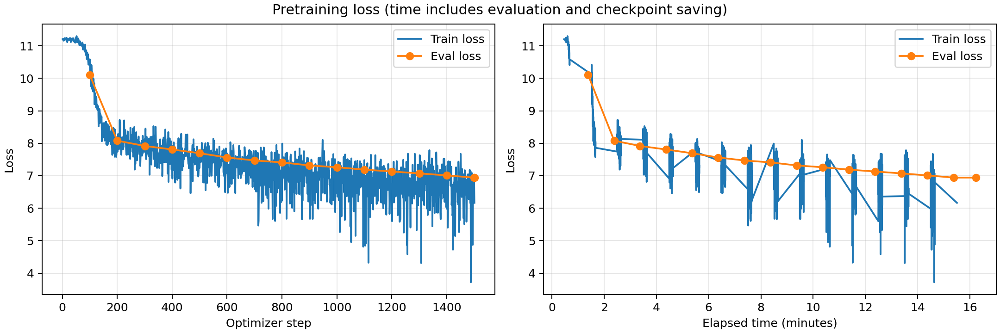

# Эксперимент: baseline

Папка запуска: `baseline_20261004T111445_258097Z` (время в имени — UTC).

## Описание эксперимента

**Гипотеза:** За короткое обучение с нуля модель начнёт усваивать локальную структуру русского текста: loss на отложенной выборке и соответствующая perplexity будут снижаться, а в генерациях появятся русские слова, устойчивые сочетания и характерные для Википедии конструкции. При этом 15-минутного бюджета может быть недостаточно для связного продолжения заданной темы.

**Что меняем и с каким запуском сравниваем:** Это первый полный запуск, baseline для последующих экспериментов. Используем исходные настройки: batch size 4, без накопления градиентов, learning rate `5e-5`, AdamW fused, 200 шагов warmup и линейный scheduler. Включены BF16, TF32 и `torch_compile`; evaluation и сохранение выполняются каждые 100 шагов. В этом запуске оцениваем динамику обучения и затраты времени, отдельного сравнения гиперпараметров пока нет.

Модель: Qwen3 из заданного конфига, обучение с нуля.
Датасет: `wikimedia/wikipedia`, `20231101.ru`; первые 5000 статей — evaluation.
Токенизатор: `ai-forever/rugpt3small_based_on_gpt2`. Длина последовательности: 512.
Лимит обучения: 900 секунд. Веса создаются в BF16.

Оборудование: одна NVIDIA A100 80 GB PCIe. Обучающая выборка содержит 1 940 063 статьи; отложенная — первые 5000 статей исходного датасета, выделенные до перемешивания обучающих примеров. Каждая статья обрезается до 512 токенов или дополняется padding до этой длины; padding исключён из расчёта loss. Seed обучения — 42.

### Настройки обучения

```json
{
  "optim": "adamw_torch_fused",
  "num_train_epochs": 1,
  "per_device_train_batch_size": 4,
  "save_steps": 100,
  "save_total_limit": 2,
  "learning_rate": 5e-05,
  "weight_decay": 0.01,
  "warmup_steps": 200,
  "logging_steps": 1,
  "eval_steps": 100,
  "eval_strategy": "steps",
  "load_best_model_at_end": true,
  "metric_for_best_model": "eval_loss",
  "bf16": true,
  "tf32": true,
  "gradient_checkpointing": false,
  "gradient_accumulation_steps": 1,
  "dataloader_num_workers": 4,
  "torch_compile": true,
  "report_to": [],
  "lr_scheduler_type": "linear",
  "seed": 42,
  "per_device_eval_batch_size": 8
}
```

## Результаты и выводы

### Метрики

| Метрика | Значение |
|---|---|
| Лучший eval_loss за время обучения | 6.942568778991699 |
| Шаг лучшего eval_loss | 1500 |
| Финальный eval_loss выбранной модели | 6.942568778991699 |
| Число шагов оптимизатора | 1501 |
| Обработано обучающих примеров | 6004 |
| Первый зарегистрированный eval_loss (шаг 100) | 10.099555969238281 |
| Perplexity выбранной модели: exp(eval_loss) | 1035.43 |
| Фактическое время срабатывания callback, секунд | 930.06 |
| Время trainer.train(), секунд | 981.6247 |

Для финальной оценки и генераций выбраны веса шага 1500. На последнем шаге 1501 значение eval_loss составило 6.9431562423706055 и оказалось немного хуже.

Время включает промежуточные оценки и сохранения; остановка проверяется после шага.
Финальная оценка, график и генерации выполняются после trainer.train().
Лимит был настроен на 900 секунд, но callback сработал через 930.06 секунды: на границе лимита выполнялись оценка и сохранение checkpoint. Поэтому фактическая длительность отличается от ровно 15 минут.

### График loss



Кривая отражает оценки во время обучения.

### Генерации

```json
{
  "max_new_tokens": 128,
  "do_sample": true,
  "temperature": 0.8,
  "top_p": 0.95,
  "top_k": 50
}
```

#### Пример 1 (seed=42)

**Промпт:**

    Москва — столица России. Город расположен

**Продолжение:**

    ена. — село в составеском районеской области.
    
    История 
    Входит в состав России.
    
    Примечания 
    
    Населённые пункты переписи 2001 года, в 2010 году.
    
    Населённые пунктыУ человек.
    
    Известныееление
    
    Национальный состав
    
    Населённые пункты Кский район
    
    Примечания
    
    Ссылки 
     Официальная страница в национальной структуре переписи в 2010 год
    
    Ссылки 
    
    Тка
    
    Ссылки 
     Официальный сайт Украины на 2003 год
    Выпускники: «Шки»
    
    Примечания
    
    Ссылки 

#### Пример 2 (seed=43)

**Промпт:**

    Солнечная система состоит из

**Продолжение:**

    рт и под-еник (191925.
    
    Биография 
    Селофная район, по территории в частности, в регионеной «Ббель».
    
    Примечания
    
    Ссылки 
    
     
     
     Официальный сайт
    
    Примечания
    
    Ссылки 
     
     
     
     
     
     
     
     
     
     
     
     
     
     
     
     
     
     
     
     
     
     
     
     
     
     
     
     
     
     
     
     
     
     
     
     
     
     
     
     
     
     
     
     
     
     
     
     
     
     
     
     
     
     
     
     
     
     
     
     
     
     
     
     
    
    

#### Пример 3 (seed=44)

**Промпт:**

    В XIX веке развитие науки

**Продолжение:**

     из́ — село в чемпионатеском районеской области.
    
    Входит в состав сельского поселения.
    
    История 
    Находится в составе 2004 года.
    
    История 
    В 1999 года в состав на расстоянии в центральной части области, в юго-мная, в состав 2002 году. В состав 2002 года, в состав село в состав района.
    
    Входит в состав района в состав сельского поселения.
    
    Улицы 
    В 1873 году была села округа на расстоянии в 2023 году.
    
    Входит в состав 2002 года, в состав сборной, на траве в селе сборнойном период с.

### Выводы

**Динамика обучения.** Гипотеза о снижении ошибки на отложенных данных подтвердилась. Eval loss уменьшился с 10.0996 на шаге 100 до 6.9426 на шаге 1500; соответствующая perplexity, рассчитанная как `exp(eval_loss)`, снизилась примерно с 24 332 до 1035. Это сравнение двух точек во время обучения: отдельная оценка модели до первого шага не проводилась. Train loss начинался около 11.2 и в целом снижался, но заметно колебался между батчами. При batch size 4 состав отдельных статей сильно влияет на значение ошибки, поэтому основной ориентир качества — evaluation на всех 5000 отложенных примерах.

**Генерации.** Модель воспроизводит русские слова и шаблоны статей: «История», «Примечания», «Ссылки», «Входит в состав». Однако продолжения слабо связаны с промптами. После запроса о Солнечной системе появляются «Биография» и «Официальный сайт», а текст о развитии науки переходит к сельским поселениям. Есть повторы, повреждённые слова, грамматические ошибки и длинные последовательности пустых строк. Эти примеры согласуются с усвоением отдельных языковых и жанровых шаблонов, но не показывают устойчивого понимания темы. Генерации необученной модели не сохранялись, поэтому прямого сравнения текстов до и после обучения нет.

**Объём обучения и learning rate.** За 1501 шаг при batch size 4 и `gradient_accumulation_steps=1` обработано 6004 примера — около 0.31% обучающей выборки. Полная эпоха не завершена. После 200 шагов warmup learning rate почти не менялся: в конце он составлял около `4.9866e-5`. Линейный scheduler был рассчитан на полную эпоху, значительно более длинную, чем запуск с остановкой по времени.

**Затраты времени.** Одна полная оценка занимала около 42–44 секунд. Пятнадцать регулярных оценок на шагах 100–1500 суммарно заняли 648.8 секунды, то есть около 10.8 минуты. Дополнительно выполнялись сохранения checkpoints и завершающие оценки. Таким образом, значительная часть временного бюджета ушла на измерение качества. Значения `train_samples_per_second` и `train_steps_per_second` из стандартного файла метрик здесь не используем: при остановке callback эта версия Trainer рассчитывает их по запланированному объёму эпохи. Фактически выполнено 1501 обновление за 981.6 секунды работы `trainer.train()`, включая оценки и сохранения.

**Следующий эксперимент.** Увеличить `eval_steps` и `save_steps` со 100 до 500, сохранив остальные параметры. Ожидаем, что более редкие оценки и сохранения позволят выполнить больше шагов за тот же лимит и снизить итоговый eval loss. Этот baseline служит исходной точкой для сравнения; сам по себе он не позволяет определить оптимальные batch size, learning rate или оптимизатор.

### Файлы результатов

- [Сводные метрики](results.json)
- [Финальная оценка](eval_results.json)
- [Метрики обучения](train_results.json)
- [История метрик и лучший checkpoint](trainer_state.json)
- [Генерации TXT](generations.txt) и [JSON](generations.json)
- [Фактическое время запуска](run_timing.json)
- [Код запуска](your_solution.py) и [Dockerfile](Dockerfile)
