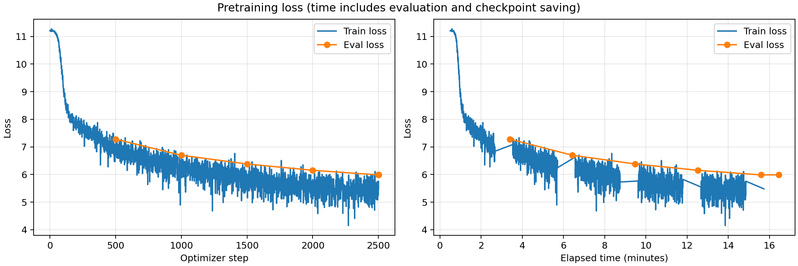

# Эксперимент: batch_size_16

Папка запуска: `batch_size_16_20261004T122757_906299Z` (время в имени — UTC).

## Описание эксперимента

**Гипотеза:** Увеличение batch size с 4 до 16 позволит обрабатывать больше обучающих примеров за заданный лимит времени на A100. Если прирост производительности компенсирует уменьшение числа обновлений весов, итоговый eval loss станет ниже при прежнем learning rate `5e-5`.

**Что меняем и с каким запуском сравниваем:** Сравниваем со [вторым экспериментом](../eval_every_500_20261004T115150_919589Z/report.md). Меняем `per_device_train_batch_size` с 4 на 16. При `gradient_accumulation_steps=1` эффективный batch на одной GPU также равен 16. Learning rate остаётся `5e-5`, evaluation и сохранение выполняются каждые 500 шагов. Оптимизатор, scheduler, warmup, dtype, `torch_compile` и остальные настройки прежние. Обучение снова начинается с нуля с seed 42.

Модель: Qwen3 из заданного конфига, обучение с нуля.
Датасет: `wikimedia/wikipedia`, `20231101.ru`; первые 5000 статей — evaluation.
Токенизатор: `ai-forever/rugpt3small_based_on_gpt2`. Длина последовательности: 512.
Лимит обучения: 900 секунд. Веса создаются в BF16.

Оборудование: одна NVIDIA A100 80 GB PCIe. Обучающая выборка содержит 1 940 063 статьи, отложенная — первые 5000 статей исходного датасета. Токенизированные данные те же, что в предыдущих запусках: одна статья обрезается или дополняется padding до 512 токенов; padding исключён из loss. Batch evaluation остаётся равным 8, оценка проходит по всем 5000 примерам.

### Настройки обучения

```json
{
  "optim": "adamw_torch_fused",
  "num_train_epochs": 1,
  "per_device_train_batch_size": 16,
  "save_steps": 500,
  "save_total_limit": 2,
  "learning_rate": 5e-05,
  "weight_decay": 0.01,
  "warmup_steps": 200,
  "logging_steps": 1,
  "eval_steps": 500,
  "eval_strategy": "steps",
  "load_best_model_at_end": true,
  "metric_for_best_model": "eval_loss",
  "bf16": true,
  "tf32": true,
  "gradient_checkpointing": false,
  "gradient_accumulation_steps": 1,
  "dataloader_num_workers": 4,
  "torch_compile": true,
  "report_to": [],
  "lr_scheduler_type": "linear",
  "seed": 42,
  "per_device_eval_batch_size": 8
}
```

## Результаты и выводы

### Метрики

| Метрика | Значение |
|---|---|
| Лучший eval_loss за время обучения | 5.985955238342285 |
| Шаг лучшего eval_loss | 2500 |
| Финальный eval_loss выбранной модели | 5.985955238342285 |
| Число шагов оптимизатора | 2501 |
| Обработано обучающих примеров | 40016 |
| Perplexity выбранной модели: exp(eval_loss) | 397.80 |
| Фактическое время срабатывания callback, секунд | 943.84 |
| Время trainer.train(), секунд | 996.3645 |

Для финальной оценки и генераций использованы лучшие веса шага 2500. На последнем шаге 2501 eval loss составил 5.988679885864258 и оказался немного хуже.

При настроенном лимите 900 секунд callback сработал через 943.84 секунды: evaluation на шаге 2500 и сохранение пересекли границу лимита. Время `trainer.train()` дополнительно включает завершающую оценку, сохранение и загрузку лучших весов. Повторная финальная оценка, график и генерации выполняются после `trainer.train()`.

### Сравнение со вторым экспериментом

| Показатель | Batch 4 | Batch 16 |
|---|---:|---:|
| Learning rate | 5e-5 | 5e-5 |
| Число шагов оптимизатора | 4501 | 2501 |
| Обработано обучающих примеров | 18004 | 40016 |
| Финальный eval_loss | 6.1543 | 5.9860 |
| Perplexity: exp(eval_loss) | 470.74 | 397.80 |
| Число регулярных evaluations | 9 | 5 |
| Суммарное время регулярных evaluations, секунд | 391.0 | 217.6 |
| Фактическое время срабатывания callback, секунд | 907.79 | 943.84 |
| Время trainer.train(), секунд | 958.9 | 996.4 |

Регулярные evaluations не включают принудительную оценку при остановке и повторную финальную оценку выбранной модели.

### График loss



Кривая отражает оценки во время обучения.

### Генерации

```json
{
  "max_new_tokens": 128,
  "do_sample": true,
  "temperature": 0.8,
  "top_p": 0.95,
  "top_k": 50
}
```

#### Пример 1 (seed=42)

**Промпт:**

    Москва — столица России. Город расположен

**Продолжение:**

     в России.
    
    Площадь 
    Полуно по состоянию на 2010 год, в 1920-е годы — 6-й графская область.
    
    Население
    
    Примечания
    
    Ссылки 
     Сайт администрации Российской империи
    
    Муниципалитеты Тасринского района
    Спортивные соревнования в России
    Списки в Германии в Великой Отечественной войне
    Города с эдитно-акадской области
    Сельские в годы в России
    События в России в Германии в России в России
    Чемпионаты России в России
    Статьи в боях в Германии
    1979-е годы

#### Пример 2 (seed=43)

**Промпт:**

    Солнечная система состоит из

**Продолжение:**

     под семейства и под семейства для.
    
    Сюжет 
    Длина и три в целом, как и других. Для рода, с теховые, как в этом же время.
    
    В результате можно не в то, так как и в случае с использованием, когда она в начале. По данным, где она была построена в том, что есть по имени, и от его в качестве быть и, а также является его и его.
    
    Ареия, в том числе и в нём.
    
    В конце XIX века, в котором и в конце его жизни, так и и бы её в том, где она

#### Пример 3 (seed=44)

**Промпт:**

    В XIX веке развитие науки

**Продолжение:**

     из и в своей составе.
    
    В период с 1939 года (с 1950) в городе Иальт (2-й дивизии, в том числе и был избран в 1820-й и был избран к востоку от 23 февраля 2015 года, когда на его имя в его честь и в 1875 году. С ноября 1816 года был награждён орденомом «Ата в Москве и был удостоен звания Героя Социалистического Труда в г. И. Г. Нойнова в Санкт-Петербурге» с 1826 года в составе Децан-Д-Бра (А. И. Х. 

### Выводы

**Результат проверки гипотезы.** При batch 16 обработано 40 016 примеров вместо 18 004 — примерно в 2.22 раза больше, хотя число обновлений уменьшилось с 4501 до 2501. Итоговый eval loss снизился с 6.1543 до 5.9860, perplexity — с 470.74 до 397.80. По этим результатам больший batch оказался полезен при ограничении времени. Однако фактическая остановка произошла на 36.05 секунды позже, чем во втором эксперименте, поэтому это сравнение одинакового настроенного лимита, а не строго одинакового времени работы.

**Производительность и объём данных.** Один шаг теперь обрабатывает вчетверо больше примеров, поэтому число шагов само по себе не характеризует скорость обработки данных. При этом batch 16 не оказался лучше по качеству на одинаковом объёме обучения: после 8000 примеров eval loss равен 7.2806 у batch 16 (500 шагов) и 6.7189 у batch 4 (2000 шагов); после 16 000 примеров — 6.6977 и 6.2323 соответственно. При прежнем learning rate меньший batch достигал меньшей ошибки за то же число примеров, но больший batch позволил обработать больше данных за доступное время.

**Связанные изменения режима обучения.** Численные значения `warmup_steps=200` и `eval_steps=500` сохранены, но теперь warmup охватывает 3200 примеров вместо 800, а между evaluations обрабатывается 8000 примеров вместо 2000. За запуск выполнено пять регулярных оценок вместо девяти; их суммарная длительность снизилась с 391.0 до 217.6 секунды. Поэтому выигрыш по времени нельзя целиком приписывать ускорению вычислений на GPU: изменилась и доля времени на evaluation и сохранения. Полная эпоха не завершена — обработано около 2.06% обучающих статей.

**Динамика loss.** Eval loss снижался от 7.2806 на шаге 500 до 5.9860 на шаге 2500. На последнем шаге ошибка немного выросла, поэтому для финальной оценки выбраны предыдущие веса. Разница между двумя последними оценками мала и сама по себе не доказывает начало переобучения. Learning rate после warmup плавно уменьшился примерно до `4.9050e-5`; заметного затухания до нуля за короткий запуск не произошло.

**Генерации.** При прежних промптах и seeds сохраняются энциклопедические заголовки, географические и биографические конструкции. Продолжение про Москву начинается с «в России», но затем переходит к несвязным категориям и повторам. Текст после промпта о Солнечной системе содержит сочетания вроде «под семейства» и не раскрывает тему. В продолжении о науке смешиваются даты, награды и вымышленные имена. Снижение eval loss не сопровождается очевидным устойчивым улучшением смысловой связности на этих трёх примерах; вывод о качестве генераций остаётся качественным и ограниченным небольшим набором промптов.

**Следующий эксперимент.** При batch 16 увеличить learning rate с `5e-5` до `1e-4`, сохранив остальные параметры обучения. Проверить, позволит ли более крупное обновление весов быстрее снижать ошибку при том же числе шагов. Текущий запуск не устанавливает оптимальный batch size: размеры 32 и 64 и другие значения накопления градиентов не проверялись.

Стандартные `train_samples_per_second` и `train_steps_per_second` из Trainer не используются для сравнения скорости: при остановке callback эта версия рассчитывает их по запланированному объёму эпохи. Число обработанных примеров рассчитано по фактическим шагам и batch size; длительность взята из сохранённых метрик и лога.

### Файлы результатов

- [Сводные метрики](results.json)
- [Финальная оценка](eval_results.json)
- [Метрики обучения](train_results.json)
- [История метрик и лучший checkpoint](trainer_state.json)
- [Генерации TXT](generations.txt) и [JSON](generations.json)
- [Фактическое время запуска](run_timing.json)
- [Код запуска](your_solution.py) и [Dockerfile](Dockerfile)
