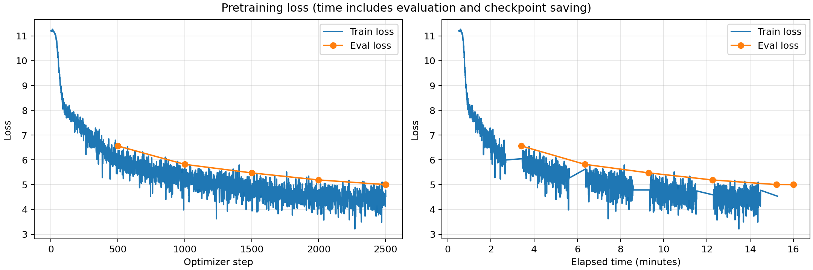

# Эксперимент: batch_size_16_lr_1e4

Папка запуска: `batch_size_16_lr_1e4_20261004T125019_788406Z` (время в имени — UTC).

## Описание эксперимента

**Гипотеза:** При batch size 16 learning rate `5e-5` может ограничивать скорость обучения в коротком запуске. Увеличение learning rate до `1e-4` позволит быстрее снижать eval loss при одинаковом числе обновлений весов и обработанных примеров, если обучение останется стабильным.

**Что меняем и с каким запуском сравниваем:** Сравниваем с [третьим экспериментом — batch 16, LR 5e-5](../batch_size_16_20261004T122757_906299Z/report.md). Увеличиваем `learning_rate` вдвое: с `5e-5` до `1e-4`. Batch size остаётся 16, `gradient_accumulation_steps=1`; evaluation и сохранение — каждые 500 шагов. Оптимизатор, scheduler, 200 шагов warmup, dtype и `torch_compile` прежние. Это независимый запуск с нуля с тем же seed 42. Дополнительно меняется только состав сохраняемых checkpoints, как указано ниже.

Модель: Qwen3 из заданного конфига, обучение с нуля.
Датасет: `wikimedia/wikipedia`, `20231101.ru`; первые 5000 статей — evaluation.
Токенизатор: `ai-forever/rugpt3small_based_on_gpt2`. Длина последовательности: 512.
Лимит обучения: 900 секунд. Веса создаются в BF16.

Оборудование: одна NVIDIA A100 80 GB PCIe. Обучающая выборка содержит 1 940 063 статьи, отложенная — первые 5000 статей исходного датасета. Используется тот же токенизированный датасет: одна статья обрезается или дополняется padding до 512 токенов; padding исключён из loss. Batch evaluation остаётся равным 8, оценка проходит по всей отложенной выборке.

Техническое отличие от предыдущего запуска: `save_only_model=True` из-за ограниченного места на диске. В checkpoints сохранены веса без состояния оптимизатора. Это сокращает время сохранения, что следует учитывать при сравнении за фиксированное время.

### Настройки обучения

```json
{
  "optim": "adamw_torch_fused",
  "num_train_epochs": 1,
  "per_device_train_batch_size": 16,
  "save_steps": 500,
  "save_total_limit": 2,
  "save_only_model": true,
  "learning_rate": 0.0001,
  "weight_decay": 0.01,
  "warmup_steps": 200,
  "logging_steps": 1,
  "eval_steps": 500,
  "eval_strategy": "steps",
  "load_best_model_at_end": true,
  "metric_for_best_model": "eval_loss",
  "bf16": true,
  "tf32": true,
  "gradient_checkpointing": false,
  "gradient_accumulation_steps": 1,
  "dataloader_num_workers": 4,
  "torch_compile": true,
  "report_to": [],
  "lr_scheduler_type": "linear",
  "seed": 42,
  "per_device_eval_batch_size": 8
}
```

## Результаты и выводы

### Метрики

| Метрика | Значение |
|---|---|
| Лучший eval_loss за время обучения | 5.001699924468994 |
| Шаг лучшего eval_loss | 2501 |
| Финальный eval_loss выбранной модели | 5.001699924468994 |
| Число шагов оптимизатора | 2501 |
| Обработано обучающих примеров | 40016 |
| Perplexity выбранной модели: exp(eval_loss) | 148.67 |
| Фактическое время срабатывания callback, секунд | 915.93 |
| Время trainer.train(), секунд | 963.4587 |

Лучшие веса получены на последнем шаге 2501 и использованы для финальной оценки и генераций. На шаге 2500 eval loss составлял 5.004124641418457; последнее обновление немного улучшило результат.

Время включает промежуточные оценки и сохранения; остановка проверяется после шага.
Финальная оценка, график и генерации выполняются после trainer.train().
При настроенном лимите 900 секунд callback сработал через 915.93 секунды, поскольку evaluation на шаге 2500 и сохранение пересекли границу лимита. Поэтому фактическая длительность отличается от ровно 15 минут.

### Сравнение с предыдущим learning rate

| Показатель | Batch 16, LR 5e-5 | Batch 16, LR 1e-4 |
|---|---:|---:|
| Число шагов оптимизатора | 2501 | 2501 |
| Обработано обучающих примеров | 40016 | 40016 |
| Eval loss на шаге 500 | 7.2806 | 6.5637 |
| Eval loss на шаге 1000 | 6.6977 | 5.8200 |
| Eval loss на шаге 1500 | 6.3826 | 5.4759 |
| Eval loss на шаге 2000 | 6.1532 | 5.1911 |
| Eval loss на шаге 2500 | 5.9860 | 5.0041 |
| Финальный eval_loss лучших весов | 5.9860 | 5.0017 |
| Perplexity: exp(eval_loss) | 397.80 | 148.67 |
| Шаг лучших весов | 2500 | 2501 |
| Фактическое время срабатывания callback, секунд | 943.84 | 915.93 |
| Время trainer.train(), секунд | 996.4 | 963.5 |
| Сохранение состояния оптимизатора в checkpoints | Да | Нет |

### График loss



Кривая отражает оценки во время обучения. Повторная оценка выбранных весов в неё не включена.

### Генерации

```json
{
  "max_new_tokens": 128,
  "do_sample": true,
  "temperature": 0.8,
  "top_p": 0.95,
  "top_k": 50
}
```

#### Пример 1 (seed=42)

**Промпт:**

    Москва — столица России. Город расположен

**Продолжение:**

     у города А-У. 
    
    Крупукает по территории посёлка К-И-3 (Степ-Мог-15) и у посёлка С-7.
    
    Имена 
    Площадь посёлка составляет 7,8 км².
    
    Известные притоки (л-Кузей) — (Петров-Ураль)
    
    Взаимодействие 
    В долине реки происходит от устья реки.
    
    Пассажиры 
     Селен-1
     Т-24
     Р-3
    
    Бес-Сили
     Б-1
     Хура-с
    
    Сос

#### Пример 2 (seed=43)

**Промпт:**

    Солнечная система состоит из

**Продолжение:**

     наиболее переменов. При этом два года здание в связи с целью использования в результате и для хранения других типов или более двух. Для того, как  может быть использован в этом же году.
    
    
    Второе время в Европе и Южной Корее (2) 
    В качестве примера в Индии в основном можно было бывшими на основе данных, чем в связи с  и  (C).
    
    В зависимости от 
    В этом случае
    
    Примечания 
    
    Ноттингология
    Флаги
    Фластроенные по алфавиту
    Языки, открытые в 2008 году
    Ушли в Великобритании
    С

#### Пример 3 (seed=44)

**Промпт:**

    В XIX веке развитие науки

**Продолжение:**

    -й воздушной армии СССР.
    
    В период с 1939 по 1931 год — председатель Государственной службы на Черноморском заводе №1 в Москве, был членом-корреспондентом в Севастополе.
    
    В 1958—1942 годах — министр транспорта, с ноября 1951 по март 1944 год — директор комиссии.
    
    С ноября 1951 по настоящее время в родном городе был избран заместителем директора, с 1979 по сентябрь 1941 — заместитель начальника, с ноября 1948 по июль 1941 — заместитель начальника Управления.
    
    В сентябре 1943 — заместитель начальника Управления МВД России в г. Н. К. Черкасской (А. И. Царьков

### Выводы

**Результат проверки гипотезы.** В этом сравнении learning rate `1e-4` оказался эффективнее `5e-5`: ошибка ниже на каждом общем шаге evaluation. Итоговый eval loss уменьшился с 5.9860 до 5.0017, perplexity — с 397.80 до 148.67. Оба запуска выполнили по 2501 обновлению и обработали по 40 016 примеров, поэтому улучшение нельзя объяснить только увеличением объёма данных или числа шагов. Гипотеза о более быстром снижении ошибки при большем learning rate подтвердилась для этих настроек и seed.

**Стабильность и динамика обучения.** Eval loss последовательно снижался от 6.5637 на шаге 500 до 5.0017 на шаге 2501. Запуск завершился успешно, в сохранённой истории train и eval loss нет нечисловых значений. После warmup learning rate постепенно уменьшился примерно до `9.8100e-5`. Достигнутый результат показывает, что `1e-4` пригоден для этого короткого запуска, но не устанавливает глобально оптимальный learning rate и не гарантирует стабильность при более длительном обучении.

**Влияние режима сохранения.** Из-за нехватки диска включён `save_only_model=True`: в checkpoint записываются веса без состояния оптимизатора. Сам оптимизатор продолжает работать во время обучения; меняется сохранение на диск. Это уменьшает затраты на запись, поэтому разницу времени между запусками нельзя приписывать learning rate. При этом оба запуска фактически завершили одинаковое число шагов, а преимущество нового learning rate видно при сравнении loss на одинаковых шагах. Фактическое время остановки всё же различается, что учтено в таблице.

**Генерации.** Сохраняются прежние промпты, seeds и параметры sampling. В текстах встречаются более оформленные фразы, например «Площадь посёлка составляет 7,8 км²», и последовательности должностей и дат в стиле биографии. Однако продолжение про Москву содержит вымышленные названия и несвязные списки, промпт о Солнечной системе не приводит к описанию планет, а текст о науке переходит к военной и административной биографии. Встречаются обратные диапазоны дат: «с 1939 по 1931 год», «В 1958—1942 годах». Есть повторы и искажённые слова. Модель лучше предсказывает токены на отложенных статьях, но эти примеры по-прежнему не демонстрируют надёжного следования теме или фактической достоверности.

**Итог серии экспериментов.** Этот запуск дал наименьший eval loss среди четырёх проведённых: baseline — 6.9426; более редкие evaluation и сохранения — 6.1543; batch 16 с LR `5e-5` — 5.9860; batch 16 с LR `1e-4` — 5.0017. Это лучший результат среди проверенных конфигураций. На каждый вариант выполнен один запуск с seed 42; отдельные сравнения оптимизаторов, `torch_compile`, BF16/TF32 и типов scheduler не проводились. Во всех запусках использовалась одна отложенная выборка, поэтому результаты характеризуют подбор настроек на ней, а не независимую итоговую проверку обобщения.

**Возможное продолжение.** Серия завершена из-за ограничения времени на сервере. При дополнительном бюджете полезно повторить сравнение learning rate с несколькими seeds и одинаковым режимом сохранения, а затем проверить соседние значения learning rate. Эти дополнительные эксперименты не проводились.

Стандартные `train_samples_per_second` и `train_steps_per_second` из Trainer не используются для сравнения скорости: при остановке callback эта версия рассчитывает их по запланированному объёму эпохи. Фактически обработано 40 016 примеров за 963.5 секунды работы `trainer.train()`, включая оценки и сохранения; финальная оценка и генерации выполнялись отдельно.

### Файлы результатов

- [Сводные метрики](results.json)
- [Финальная оценка](eval_results.json)
- [Метрики обучения](train_results.json)
- [История метрик и лучший checkpoint](trainer_state.json)
- [Генерации TXT](generations.txt) и [JSON](generations.json)
- [Фактическое время запуска](run_timing.json)
- [Особенности сохранения checkpoints](storage_note.json)
- [Код запуска](your_solution.py) и [Dockerfile](Dockerfile)
