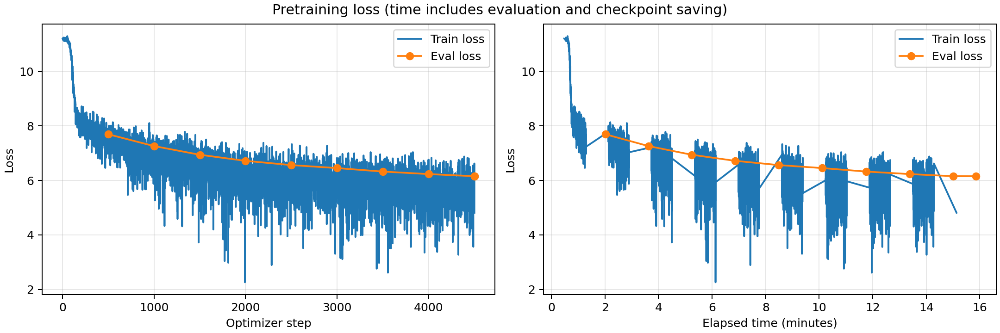

# Эксперимент: eval_every_500

Папка запуска: `eval_every_500_20261004T115150_919589Z` (время в имени — UTC).

## Описание эксперимента

**Гипотеза:** Если реже запускать полную оценку и сохранять checkpoints, больше времени из 15-минутного бюджета останется на обновление весов. При прежних параметрах обучения модель успеет обработать больше примеров и достигнет меньшего итогового eval loss. При одинаковом числе обучающих шагов ожидаем близкие значения ошибки к baseline.

**Что меняем и с каким запуском сравниваем:** Сравниваем с [первым экспериментом — baseline](../baseline_20261004T111445_258097Z/report.md). Меняем только частоту evaluation и сохранения: `eval_steps` и `save_steps` увеличены со 100 до 500. Batch size остаётся 4, `gradient_accumulation_steps=1`, learning rate — `5e-5`; оптимизатор, scheduler, warmup, dtype и `torch_compile` прежние. Train loss по-прежнему записывается каждый шаг. Это независимое обучение с нуля с тем же seed 42, а не продолжение baseline.

Модель: Qwen3 из заданного конфига, обучение с нуля.
Датасет: `wikimedia/wikipedia`, `20231101.ru`; первые 5000 статей — evaluation.
Токенизатор: `ai-forever/rugpt3small_based_on_gpt2`. Длина последовательности: 512.
Лимит обучения: 900 секунд. Веса создаются в BF16.

Оборудование: одна NVIDIA A100 80 GB PCIe. Обучающая выборка содержит 1 940 063 статьи, отложенная — первые 5000 статей исходного датасета. Используются те же токенизированные данные, что и в baseline: одна статья обрезается или дополняется padding до 512 токенов, padding исключён из loss. Каждая evaluation проходит по всей отложенной выборке; меняется только частота её запуска.

### Настройки обучения

```json
{
  "optim": "adamw_torch_fused",
  "num_train_epochs": 1,
  "per_device_train_batch_size": 4,
  "save_steps": 500,
  "save_total_limit": 2,
  "learning_rate": 5e-05,
  "weight_decay": 0.01,
  "warmup_steps": 200,
  "logging_steps": 1,
  "eval_steps": 500,
  "eval_strategy": "steps",
  "load_best_model_at_end": true,
  "metric_for_best_model": "eval_loss",
  "bf16": true,
  "tf32": true,
  "gradient_checkpointing": false,
  "gradient_accumulation_steps": 1,
  "dataloader_num_workers": 4,
  "torch_compile": true,
  "report_to": [],
  "lr_scheduler_type": "linear",
  "seed": 42,
  "per_device_eval_batch_size": 8
}
```

## Результаты и выводы

### Метрики

| Метрика | Значение |
|---|---|
| Лучший eval_loss за время обучения | 6.154300689697266 |
| Шаг лучшего eval_loss | 4501 |
| Финальный eval_loss выбранной модели | 6.154300689697266 |
| Число шагов оптимизатора | 4501 |
| Обработано обучающих примеров | 18004 |
| Первый зарегистрированный eval_loss (шаг 500) | 7.694159984588623 |
| Perplexity выбранной модели: exp(eval_loss) | 470.74 |
| Фактическое время срабатывания callback, секунд | 907.79 |
| Время trainer.train(), секунд | 958.9039 |

Для финальной оценки и генераций использованы лучшие веса шага 4501, выбранные из checkpoint `checkpoint-4501` во время запуска. Оценка на шаге 4500 составляла 6.155261039733887; последнее обновление немного улучшило результат.
Его веса и токенизатор сохранены на сервере в папке `/home/edu/hw1_llm_pretrain_mavletova/output_dir/experiments/eval_every_500_20261004T115150_919589Z`.
Время включает промежуточные оценки и сохранения; остановка проверяется после шага.
Финальная оценка, график и генерации выполняются после trainer.train().
При настроенном лимите 900 секунд callback сработал через 907.79 секунды: оценка на шаге 4500 и последующее сохранение пересекли границу лимита. Поэтому сравниваем запуски с одинаковым заданным бюджетом, учитывая небольшое различие фактического времени остановки.

### Сравнение с baseline

| Показатель | Baseline | Evaluation каждые 500 шагов |
|---|---:|---:|
| Интервал evaluation и сохранения, шагов | 100 | 500 |
| Число шагов оптимизатора | 1501 | 4501 |
| Обработано обучающих примеров | 6004 | 18004 |
| Финальный eval_loss | 6.9426 | 6.1543 |
| Perplexity: exp(eval_loss) | 1035.43 | 470.74 |
| Число регулярных evaluations | 15 | 9 |
| Суммарное время регулярных evaluations, секунд | 648.8 | 391.0 |
| Eval loss на шаге 1500 | 6.94257 | 6.94258 |
| Время до окончания evaluation на шаге 1500, секунд | 922.7 | 314.3 |

Регулярные evaluations в таблице не включают принудительную оценку при остановке и повторную финальную оценку выбранной модели. Время до оценки шага 1500 отсчитывается от начала обучения и включает предыдущие оценки и сохранения.

### График loss



Кривая отражает оценки во время обучения. Повторная оценка выбранных весов в неё не включена.

### Генерации

```json
{
  "max_new_tokens": 128,
  "do_sample": true,
  "temperature": 0.8,
  "top_p": 0.95,
  "top_k": 50
}
```

#### Пример 1 (seed=42)

**Промпт:**

    Москва — столица России. Город расположен

**Продолжение:**

     в России.
    
    Площадь 
    Расположена на расстоянии в северо-западной части Тверской губернии.
    
    Известные уроженцы 
    Гражданская волостопримечательности 
      Т. В. М. Б. М.: Архивский, М. В. Т. 3.
     В. И. В. Н. И. Шнии.
     Комвалерская, А. П. П. Име-Н. В. К. К. И. С. Свова и от Парижа.
    
    Ссылки 

#### Пример 2 (seed=43)

**Промпт:**

    Солнечная система состоит из

**Продолжение:**

     прит и под в виде до 6-ди.
    
    Входит в состав провинции 3-е и 20.
    
    История 
    В 1839 году в 1771 году, в деревне с 1854 года. В начале XX века была переименована в 1820 году в 7 дворов.
    
    В 1839 году окончил было в рамках 3,5 км². В селе от деревни река, 3,3 % от 2,1 жителей.
    
    В начале XX века составляет 302 человека (25 мужчин,8 женщин), 131 человек (38 мужчин и 12 женщин), и 2-е, 10 км²

#### Пример 3 (seed=44)

**Промпт:**

    В XIX веке развитие науки

**Продолжение:**

    -йос (1825—1971).
    
    Биография 
    Родился в городе Локлинском районе Вологодской области, в 1930-х годы в боях в колхозе. Был был удостоен звания Героя. С 1-й степени. Член КПСС. С 1944 года — на пенсию.
    
    В начале XX века по 12 декабря 2015 года — в селе № 7-го гвардейской ССР, в селе Сальваб, 1-й гвардейской области, в селе Ситно-яскую и в деревне в составе. В составе — в 18-й степени.
    
    В 1832

### Выводы

**Результат проверки гипотезы.** В этом запуске гипотеза подтвердилась: выполнено почти втрое больше шагов и обработано 18 004 примера вместо 6004. Итоговый eval loss снизился с 6.9426 до 6.1543, соответствующая perplexity — с 1035.43 до 470.74. Эти результаты получены на одной и той же отложенной выборке. Модель обработала около 0.93% обучающих статей, поэтому полная эпоха по-прежнему не завершена.

**Почему улучшился результат.** На одинаковом шаге траектории обучения практически совпадают: на шаге 1500 eval loss равен 6.94257 у baseline и 6.94258 у второго эксперимента. Но эта оценка завершилась через 314.3 секунды вместо 922.7 секунды. Это согласуется с гипотезой, что основное преимущество получено за счёт большего числа обновлений за доступное время. Одна evaluation всё ещё занимает около 43 секунд; девять регулярных оценок суммарно заняли 391.0 секунды против 648.8 секунды у baseline. Частота оценок уменьшилась в пять раз, но их общее число за запуск сократилось с 15 до 9, поскольку модель успела сделать намного больше шагов.

**Динамика loss и ограничения сравнения.** Eval loss снижался на всех зарегистрированных точках: от 7.6942 на шаге 500 до 6.1543 на шаге 4501. Train loss также снижался, сохраняя колебания между небольшими батчами. Первая оценка теперь происходит позже, поэтому её нельзя напрямую сравнивать с первой оценкой baseline на шаге 100 как с одинаковой начальной точкой. Более редкие измерения дают менее подробную кривую eval loss и могут пропустить лучший промежуточный checkpoint; в данном запуске лучшими оказались последние веса. Это одиночное сравнение с одним seed, без оценки разброса между повторными запусками.

**Генерации.** При тех же промптах, seeds и настройках генерации появились более длинные фрагменты в стиле энциклопедических статей: описания расположения, населения и биографий. Продолжение промпта о Москве начинается с «в России», но затем содержит искажённые слова и несвязные перечисления. Промпт о Солнечной системе снова уводит модель к деревням, датам и населению; промпт о науке — к биографии. Повторы и грамматические ошибки сохраняются. Снижение eval loss показывает улучшение предсказания токенов, но эти три примера ещё не демонстрируют устойчивого следования теме или фактической достоверности.

**Следующий эксперимент.** Сохранить evaluation и сохранение каждые 500 шагов и увеличить batch size с 4 до 16 при прежнем learning rate `5e-5`. Проверить, позволит ли это обработать больше примеров за заданное время и дополнительно снизить eval loss. При таком сравнении учитывать число примеров, а не только шагов, поскольку объём данных на одно обновление увеличится вчетверо.

Для оценки скорости не используются стандартные `train_samples_per_second` и `train_steps_per_second` из Trainer: при остановке callback в этой версии они рассчитаны по запланированному объёму эпохи. Фактически выполнено 4501 обновление за 958.9 секунды работы `trainer.train()`, включая оценки и сохранения; это около 4.69 обновления в секунду в среднем за весь этот интервал.

### Файлы результатов

- [Сводные метрики](results.json)
- [Финальная оценка](eval_results.json)
- [Метрики обучения](train_results.json)
- [История метрик и лучший checkpoint](trainer_state.json)
- [Генерации TXT](generations.txt) и [JSON](generations.json)
- [Фактическое время запуска](run_timing.json)
- [Код запуска](your_solution.py) и [Dockerfile](Dockerfile)
