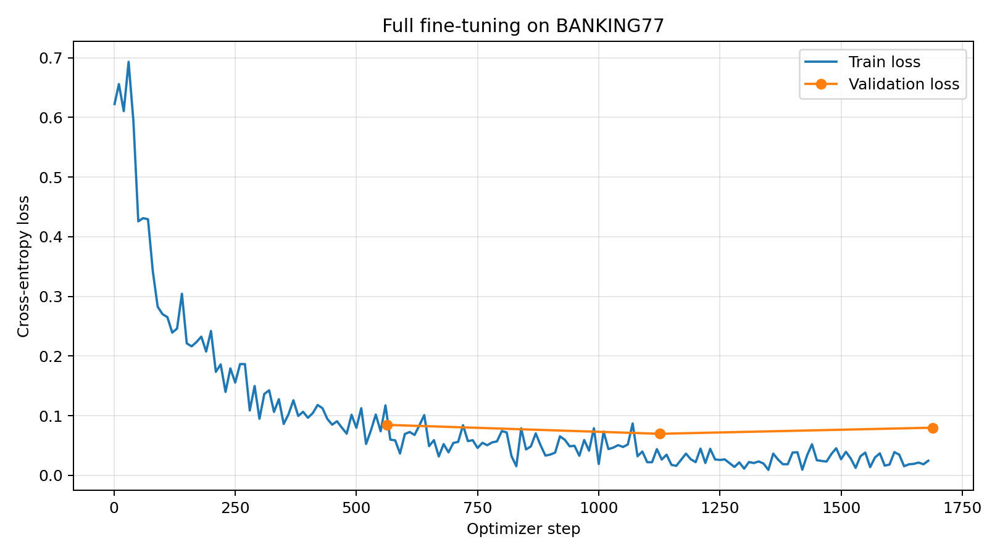
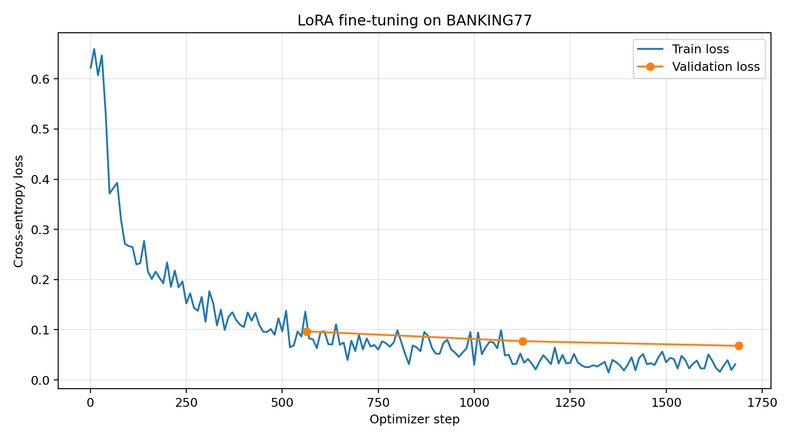

## Датасет

Для экспериментов выбран **BANKING77** от PolyAI — англоязычный датасет обращений пользователей по вопросам банковского обслуживания. Каждому обращению присвоена одна из 77 категорий намерения: доставка карты, проблемы с оплатой, переводы, снятие наличных и другие. Датасет содержит 13 083 примера: 10 003 в обучающей выборке и 3 080 в тестовой. Используется готовый датасет — вариант А задания. Источники: [карточка BANKING77](https://huggingface.co/datasets/PolyAI/banking77), [репозиторий авторов](https://github.com/PolyAI-LDN/task-specific-datasets#banking).

**Обоснование выбора.** BANKING77 позволяет сравнить Full Fine-Tuning и LoRA на конкретной задаче с однозначной целевой разметкой. Близкие по смыслу категории требуют различать детали обращения, а короткие входные тексты и ответы удобны для серии экспериментов с гиперпараметрами. Качество можно оценить автоматически по Accuracy и Macro-F1, а ошибки — разобрать вручную по перепутанным категориям. Практическое применение задачи — маршрутизация обращений в нужный сценарий поддержки.

**Примеры из датасета.** Ниже приведены исходные английские тексты и их метки из [карточки датасета](https://huggingface.co/datasets/PolyAI/banking77) и [примеров авторов](https://github.com/PolyAI-LDN/task-specific-datasets#banking).

| Текст обращения | Категория | Значение категории |
|---|---|---|
| I am still waiting on my card? | `card_arrival` | Карта ещё не доставлена |
| I think my card is broken | `card_not_working` | Карта не работает |
| I made a mistake and need to cancel a transaction | `cancel_transfer` | Отмена перевода |

**Target.** Целевая переменная — категория намерения пользователя. Это многоклассовая классификация: для каждого текста нужно предсказать ровно одну из 77 меток. В версии Hugging Face целевая метка хранится в поле `label`; при подготовке данных её числовой ID будет преобразован в название категории. Для Qwen задача будет оформлена как генерация короткого ответа: на вход подаётся инструкция и текст обращения, ожидаемый ответ — только название категории, например `card_not_working`, без объяснений. Модель должна определить тип обращения, а не составить ответ клиенту или выполнить банковскую операцию.

## Полное дообучение (Full FT)

Модель **Qwen2.5-1.5B-Instruct** обучена на BANKING77 в течение трёх эпох. Обновлялись все **1,543,714,304 параметров**, то есть 100% весов модели. Обучение выполнено скриптом [train_full_ft.py](train_full_ft.py) на GPU 1 — NVIDIA A100-SXM4-80GB.

### Подготовка данных и настройки

Официальная обучающая выборка разделена на **9 002 train-примера и 1 001 validation-пример** с сохранением пропорций классов и `seed=42`. Индексы и контрольные суммы исходных данных сохранены в [data_split.json](outputs/full_ft/data_split.json); это же разбиение использовано для LoRA. Официальный test из 3 080 примеров в обучении и валидации не использовался.

Модель получает инструкцию со списком 77 категорий и текст обращения. Целевой ответ — название категории. Cross-entropy считается только по токенам категории и EOS; инструкция, обращение и padding исключены из loss метками `-100`. Максимальная длина примеров составила 534 токена для train и 517 для validation, поэтому ограничение 1 024 токена не привело к обрезанию данных.

| Параметр | Значение |
|---|---|
| Эпохи / шаги оптимизатора | 3 / 1 689 |
| Batch size / накопление градиентов | 2 / 8 |
| Эффективный batch size | 16 |
| Оптимизатор | AdamW |
| Максимальный learning rate | `2e-5` |
| Расписание learning rate | Линейный warmup на первых 10% шагов, затем линейное снижение |
| Weight decay / ограничение нормы градиентов | 0,01 / 1,0 |
| Точность / gradient checkpointing | BF16 / включён |
| Валидация | После каждой эпохи |
| Сохранённая модель | Финальная, после третьей эпохи |

Полная конфигурация и версии библиотек: [run_config.json](outputs/full_ft/run_config.json).

### Результаты обучения

| Эпоха | Шаг валидации | Последний записанный train loss | Validation loss |
|---|---:|---:|---:|
| 1 | 563 | 0.1174 (шаг 560) | 0.0847 |
| 2 | 1126 | 0.0440 (шаг 1120) | 0.0697 |
| 3 | 1689 | 0.0246 (шаг 1680) | 0.0800 |

Train loss в таблице относится к последнему интервалу логирования перед валидацией, а не к среднему за эпоху. Средний train loss за весь запуск — **0.0932**.

| Вычислительные затраты | Значение |
|---|---:|
| Обучаемые параметры | 1,543,714,304 (100%) |
| Время обучения с валидацией | 35 мин 53 с |
| Пиковая память тензоров PyTorch (`allocated`) | 14.41 GiB |
| Пиковая память, зарезервированная PyTorch (`reserved`) | 25.57 GiB |

Время включает проходы по validation, но не загрузку модели, подготовку данных и финальное сохранение. Память измерялась для текущего процесса во время обучения; `reserved` включает кэш аллокатора и не равен объёму памяти активных тензоров. Исходные результаты: [training_metrics.json](outputs/full_ft/training_metrics.json), [история loss](outputs/full_ft/log_history.csv).

## Дообучение с LoRA

Исходная **Qwen2.5-1.5B-Instruct** дообучена с LoRA на BANKING77 в течение трёх эпох. Базовые веса заморожены; обновлялись только **4,358,144 параметра адаптеров** — **0.282%** от 1,548,072,448 параметров модели с адаптерами. Использовалась исходная модель, а не результат Full FT. Обучение выполнено скриптом [train_lora.py](train_lora.py) на GPU 1 — NVIDIA A100-SXM4-80GB.

### Подготовка данных и настройки

Использованы те же **9 002 train-примера и 1 001 validation-пример**, что и для Full FT. Совпадение разбиения, контрольных сумм данных и системной инструкции проверено по сохранённым файлам. Разбиение: [data_split.json](outputs/lora/data_split.json). Официальный test из 3 080 примеров в обучении и валидации не использовался.

Формат запроса и целевой ответ совпадают с Full FT: инструкция со списком категорий и обращение на входе, название категории на выходе. Cross-entropy считается только по токенам категории и EOS. Максимальная длина примеров — 534 токена для train и 517 для validation; обрезания при ограничении 1 024 токена не было.

| Параметр | Значение |
|---|---|
| Эпохи / шаги оптимизатора | 3 / 1 689 |
| Batch size / накопление градиентов | 2 / 8 |
| Эффективный batch size | 16 |
| Оптимизатор | AdamW |
| Максимальный learning rate | `2e-4` |
| Расписание learning rate | Линейный warmup на первых 10% шагов, затем линейное снижение |
| Weight decay / ограничение нормы градиентов | 0,01 / 1,0 |
| Точность | Базовые веса BF16, адаптеры FP32 |
| Gradient checkpointing | Включён |
| Ранг `r` | 16 |
| `lora_alpha` / масштаб `alpha / r` | 32 / 2 |
| `lora_dropout` | 0,05 |
| `target_modules` | `q_proj`, `k_proj`, `v_proj`, `o_proj` во всех блоках attention |
| Bias / rsLoRA / DoRA | Не обучается / выключена / выключена |
| Валидация | После каждой эпохи |
| Сохранённый адаптер | Финальный, после третьей эпохи |

Learning rate для LoRA в 10 раз выше, чем для Full FT (`2e-4` против `2e-5`); поэтому сравниваются два запуска с разными настройками learning rate. Полная конфигурация и версии библиотек: [run_config.json](outputs/lora/run_config.json).

### Результаты обучения

| Эпоха | Шаг валидации | Последний записанный train loss | Validation loss |
|---|---:|---:|---:|
| 1 | 563 | 0.1360 (шаг 560) | 0.0968 |
| 2 | 1126 | 0.0526 (шаг 1120) | 0.0773 |
| 3 | 1689 | 0.0312 (шаг 1680) | 0.0680 |

Train loss в таблице относится к последнему интервалу логирования перед валидацией, а не к среднему за эпоху. Средний train loss за весь запуск — **0.1013**.

| Вычислительные затраты | Значение |
|---|---:|
| Обучаемые параметры | 4,358,144 (0.282% модели с адаптерами) |
| Время обучения с валидацией | 54 мин 14 с |
| Пиковая память тензоров PyTorch (`allocated`) | 4.87 GiB |
| Пиковая память, зарезервированная PyTorch (`reserved`) | 13.63 GiB |

Время включает проходы по validation, но не загрузку модели, подготовку данных и финальное сохранение. Память измерялась для текущего процесса во время обучения; `reserved` включает кэш аллокатора. Исходные результаты: [training_metrics.json](outputs/lora/training_metrics.json), [история loss](outputs/lora/log_history.csv).

### Вывод

Validation loss снижался после каждой эпохи: **0.0968 → 0.0773 → 0.0680**; роста validation loss за три эпохи не наблюдалось. Финальное значение ниже, чем у финальной модели Full FT (**0.0800**), и немного ниже лучшего значения Full FT на второй эпохе (**0.0697**). Это сравнение токенового loss; результаты Accuracy и Macro-F1 на тесте приведены в разделе «Оценка моделей».

LoRA обучала примерно в **354 раза меньше параметров** и потребовала почти в **3 раза меньше пиковой памяти активных тензоров**, чем Full FT. Ускорения в этом запуске не получилось: обучение заняло **54 мин 14 с против 35 мин 53 с**, то есть на **51% дольше**. Логи фиксируют разницу во времени, но не позволяют установить её причину. Сравнение качества обеих моделей на общем тесте приведено в разделе «Оценка моделей».

## Оценка моделей

Все пять вариантов модели оценены на одних и тех же **3 080 обращениях официального теста BANKING77**. Использованы одинаковая инструкция со списком категорий и greedy-генерация. Ответ засчитывается только при точном совпадении с названием категории после удаления пробелов и переносов по краям; неизвестные категории и лишние пояснения считаются ошибками.

### Качество классификации

**Accuracy** показывает долю правильно классифицированных обращений. **Macro-F1** усредняет F1 по всем 77 категориям с одинаковым весом каждого класса и позволяет оценить баланс точности и полноты по категориям. Обе метрики непосредственно оценивают задачу дообучения.

| Модель | Accuracy, % ↑ | Macro-F1, % ↑ | Ответы вне списка категорий ↓ |
|---|---:|---:|---:|
| Base | 40.52 | 37.82 | 202 |
| Full FT | 92.53 | 92.60 | 6 |
| LoRA attention (`r=16`) | 92.47 | 92.46 | 3 |
| LoRA attention (`r=8`) | 92.66 | 92.62 | 1 |
| LoRA attention + MLP (`r=16`) | 94.16 | 94.18 | 3 |

Во всех представленных результатах ответы завершились токеном EOS; обрыва по лимиту генерации не было.

В обоих вариантах **LoRA attention (`r=16`) и LoRA attention (`r=8`)** адаптеры установлены в проекциях `q_proj`, `k_proj`, `v_proj`, `o_proj` attention-части **каждого из 28 Transformer-блоков** — всего в 112 линейных слоях для каждого варианта. У каждого слоя свой адаптер.

В варианте attention + MLP адаптеры добавлены в `q_proj`, `k_proj`, `v_proj`, `o_proj`, `gate_proj`, `up_proj`, `down_proj` всех 28 блоков. Относительно LoRA attention изменён только `target_modules`: `r=16`, `alpha=32`, `dropout=0.05` и остальные настройки обучения сохранены. Источники: [конфигурация обучения](outputs/lora_attention_mlp/run_config.json), [метрики теста](outputs/evaluation_attention_mlp/metrics.json), [настройки оценки](outputs/evaluation_attention_mlp/evaluation_config.json).

В варианте LoRA attention `r=8` сохранены `alpha=32`, `dropout=0.05` и проекции `q_proj`, `k_proj`, `v_proj`, `o_proj`. Масштаб `alpha/r` вырос с 2 до 4. Источники: [конфигурация обучения](outputs/lora_r8/run_config.json), [метрики теста](outputs/evaluation_r8/metrics.json), [настройки оценки](outputs/evaluation_r8/evaluation_config.json).

### Примеры ответов

Пять одинаковых обращений с эталонными категориями и ответами Base, Full FT и LoRA attention (`r=16`) приведены в [answers_example.md](answers_example.md).

### Вычислительные затраты

| Модель | Обучаемые параметры | Доля, % | Время обучения с валидацией | Пик allocated, GiB | Пик reserved, GiB |
|---|---:|---:|---|---:|---:|
| Full FT | 1,543,714,304 | 100 | 35 мин 53 с | 14.41 | 25.57 |
| LoRA attention (`r=16`) | 4,358,144 | 0.282 | 54 мин 14 с | 4.87 | 13.63 |
| LoRA attention (`r=8`) | 2,179,072 | 0.141 | 52 мин 19 с | 4.84 | 13.59 |
| LoRA attention + MLP (`r=16`) | 18,464,768 | 1.182 | 1 ч 8 мин 19 с | 5.08 | 13.94 |

Доля параметров для LoRA рассчитана относительно модели вместе с адаптерами. Время не включает загрузку модели, подготовку данных и финальное сохранение. Память относится к процессу обучения; `allocated` отражает активные тензоры, `reserved` включает кэш PyTorch. Это не полный расход GPU-памяти по `nvidia-smi`. Источники: метрики обучения [Full FT](outputs/full_ft/training_metrics.json), [LoRA attention r=16](outputs/lora/training_metrics.json), [LoRA attention r=8](outputs/lora_r8/training_metrics.json) и [LoRA attention + MLP](outputs/lora_attention_mlp/training_metrics.json).

### Вывод по оценке

Оба способа дообучения существенно улучшили классификацию: Accuracy выросла с **40.52%** у исходной модели до **92.53%** у Full FT и **92.47%** у LoRA attention; Macro-F1 — с **37.82%** до **92.60%** и **92.46%** соответственно. Число ответов вне списка категорий сократилось с 202 до 6 и 3.

Качество Full FT и LoRA attention в этих запусках практически совпало: преимущество Full FT составляет **0.065 процентного пункта Accuracy**, то есть всего **два дополнительных правильных ответа из 3 080**, и **0.145 процентного пункта Macro-F1**. На пяти выбранных примерах исходная модель дала один правильный ответ, обе дообученные — пять; эта небольшая подборка иллюстрирует результат, но не заменяет оценку на всём тесте.

Для выбранной задачи **LoRA attention предпочтительнее Full FT при ограничении GPU-памяти**: сопоставимое качество получено при примерно в **354 раза меньшем числе обучаемых параметров** и почти в **3 раза меньшей пиковой памяти активных тензоров**. По времени в проведённых запусках выиграл Full FT: LoRA attention обучалась на **51% дольше**. Сравнение относится к этим конфигурациям и одному запуску каждого метода; learning rate различался (`2e-5` у Full FT и `2e-4` у LoRA).

Добавление адаптеров в MLP дало лучший результат среди представленных конфигураций: **Accuracy 94.16% и Macro-F1 94.18%**. Относительно LoRA только в attention прирост составил **1.69 п.п. Accuracy** (52 дополнительных правильных ответа) и **1.73 п.п. Macro-F1**. Обучаемых параметров стало в **4.24 раза больше**, время выросло примерно на **26%**, а пиковая память активных тензоров — с **4.87 до 5.08 GiB**. Таким образом, attention + MLP оказался предпочтительнее по качеству при небольшом увеличении расхода GPU-памяти, но более долгом обучении.
