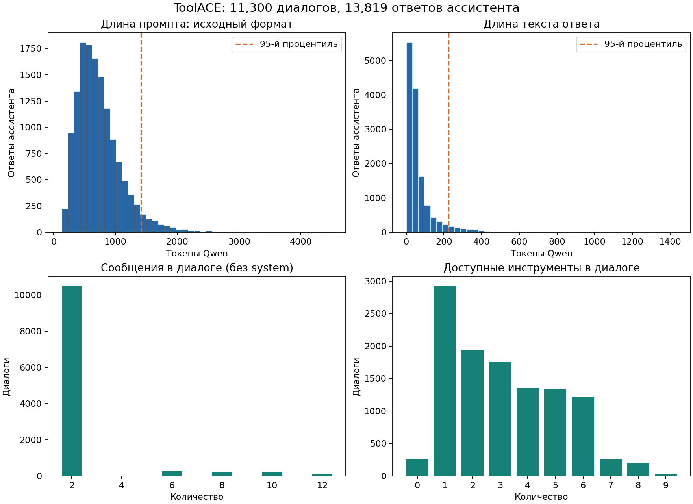
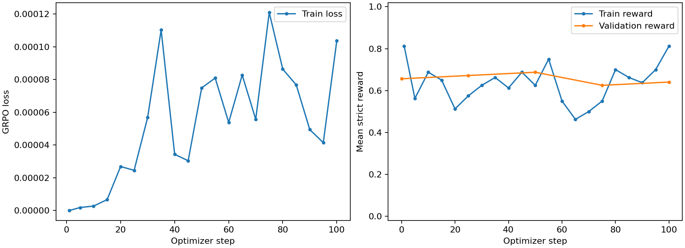
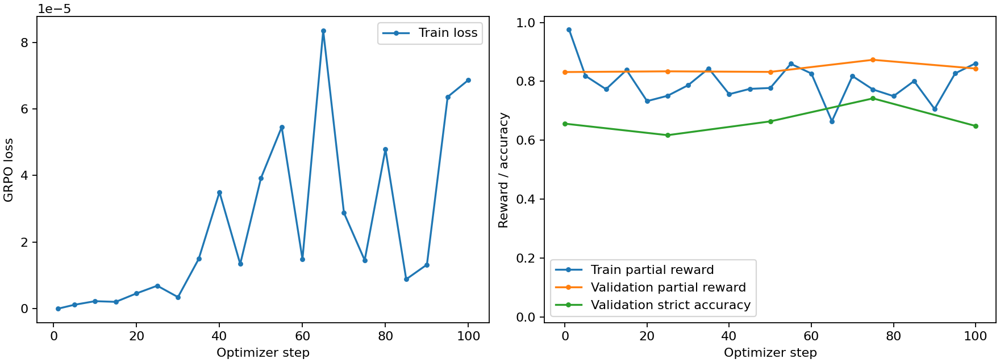
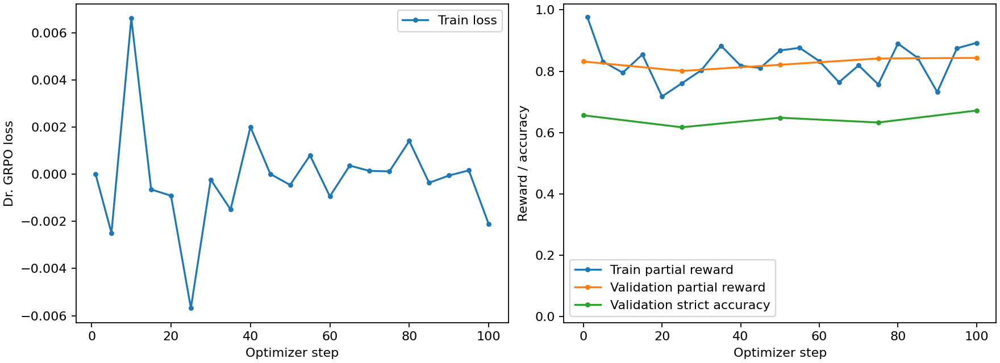

# Подготовка данных

## 1. Данные и источник

Для RL-обучения используется [Team-ACE/ToolACE](https://huggingface.co/datasets/Team-ACE/ToolACE) — датасет диалогов для обучения вызову инструментов.

Каждая запись содержит `system` с инструкциями и описаниями доступных инструментов и `conversations` — сообщения пользователя, ассистента и, при наличии, результаты работы инструментов. Ответ ассистента может содержать один или несколько вызовов, уточняющий вопрос либо обычный текст.

Всего в датасете **11 300 диалогов и 27 638 сообщений**, из которых **13 819 — ответы ассистента**. Для обучения и валидации используются только данные ToolACE. Предоставленный [bfcl.jsonl](bfcl.jsonl) предназначен для отдельной итоговой оценки и не участвует в подготовке train/val.

## 2. Базовый EDA и выводы

Код скачивания и анализа: [scripts/download_and_eda.py](scripts/download_and_eda.py). Численные результаты: [results/eda/summary.json](results/eda/summary.json).


| Показатель | Среднее | Медиана | 95-й процентиль | Максимум |
|---|---:|---:|---:|---:|
| Сообщения в диалоге, без `system` | 2,45 | 2 | 6 | 12 |
| Доступные инструменты в диалоге | 3,12 | 3 | 6 | 9 |
| Длина промпта, токены | 733,18 | 662 | 1 414 | 4 507 |
| Длина ответа, токены | 65,12 | 40 | 225 | 1 436 |



Основные выводы:

- Большинство диалогов короткие, ответы обычно значительно короче промптов. При этом есть длинные примеры, поэтому перед обучением нужна проверка длины, а не только среднего значения.
- В исходном формате **99,9% промптов** помещаются в контекст 4 096 токенов с резервом 1 024 токена для ответа. Это предварительная оценка: после преобразования инструментов и вызовов в формат Qwen длины проверяются заново.
- JSON-описания инструментов есть в **10 800 диалогах**, нестандартные описания — в **486**, ещё в **14** блок инструментов отсутствует. Для первой версии подготовки выбраны записи с JSON-описаниями.
- Найдены **5 пустых сообщений**, **3 полных дубликата сверх первого экземпляра** и **18 повторов истории без учёта `system`**. Последние могут иметь разные инструменты; при разбиении необходимо учитывать совпадающие запросы.
- Текст после результата инструмента нужно отличать от решения не вызывать инструмент. Классификация ответов в EDA основана на внешнем формате: она не проверяет корректность вызовов и не доказывает принадлежность текстового ответа к категории Irrelevance.

EDA охватывает все ответы ассистента, включая поздние ходы диалога. Поэтому его статистики не следует напрямую считать статистиками итоговых train/val.

## 3. Формирование train и validation

Подготовка реализована в [scripts/prepare_data.py](scripts/prepare_data.py). Выбран простой вариант: **из каждого диалога берётся только первый запрос пользователя и первый ответ ассистента**. Последующие ходы не используются. Это позволяет сосредоточиться на выборе инструментов и аргументов, не смешивая эти примеры с пересказом результатов инструментов.

Каждый подготовленный пример содержит:

| Поле | Содержимое |
|---|---|
| `dialogue_id` | Идентификатор исходного диалога |
| `prompt` | Системный контекст и первый запрос пользователя |
| `tools` | Список функций с описаниями и схемами параметров |
| `reference.calls` | Эталонные вызовы: имя функции и словарь аргументов; пустой список для ответа без вызова |

Из `system` извлекаются JSON-описания инструментов. Типы `dict`, `int`, `float`, `bool` приводятся к типам JSON Schema. Имена функций нормализуются одинаково в инструментах и эталонах; названия параметров и значения аргументов сохраняются. Системный контекст, включая даты, остаётся в промпте, а исходная инструкция о формате вызовов заменяется оформлением через chat template Qwen.

Эталонные вызовы разбираются через AST и `ast.literal_eval`, без исполнения функций. Проверяются схемы, обязательные параметры, типы и отсутствие неизвестных аргументов. Поддерживаемые текстовые ответы получают `reference.calls = []`; качество самого текста такой эталон не оценивает. Эталон хранится отдельно от промпта и предназначен для функции награды, а не для SFT.

После преобразования проверяется длина: не более **3 072 токенов промпта** и **1 024 токенов эталонного продолжения**. Слишком длинные примеры исключаются без усечения. Последовательная фильтрация дала следующие результаты:

| Причина исключения | Примеров |
|---|---:|
| Нет поддерживаемого JSON-блока инструментов | 500 |
| Некорректная или неподдерживаемая схема либо эталон | 110 |
| Пустой первый ответ | 5 |
| Превышен лимит длины | 3 |
| Дубликат промпта с теми же инструментами | 3 |
| **Всего исключено** | **621** |
| **Осталось** | **10 679** |

Перед разбиением первые запросы нормализуются по регистру и пробелам и группируются по совпадению текста. Одинаковые запросы, даже с разными наборами инструментов, остаются в одном сплите. Ключи групп сортируются, перемешиваются с **seed = 42** и делятся в пропорции **90/10 по группам**, поэтому доля по числу примеров приблизительная. Пересечения по ID диалогов, совпадающим историям и нормализованным запросам проверены и отсутствуют.

| Выборка | Один вызов | Несколько вызовов | Без вызова | Всего |
|---|---:|---:|---:|---:|
| [data/train.jsonl](data/train.jsonl) | 4 567 | 3 608 | 1 439 | **9 614** |
| [data/val.jsonl](data/val.jsonl) | 515 | 401 | 149 | **1 065** |

При подготовке файлов к публикации две строки, похожие на GitHub-токены, в значениях по умолчанию параметра `key` заменены на `REDACTED_GITHUB_TOKEN` (примеры `toolace_06236` и `toolace_04427`). Такая замена добавлена в сохранение файлов в `prepare_data.py`; состав и разбиение примеров не меняются. Описанные эксперименты выполнены до этой замены. Контрольная сумма train в сохранённых конфигурациях относится к исходному файлу обучения, поэтому отличается от опубликованной копии.

Train предназначен для RL-обучения, validation — для проверки качества и выбора чекпоинта. Команды воспроизведения внутри подготовленного Docker-контейнера, из корня проекта:

```bash
python3 scripts/download_and_eda.py
python3 scripts/prepare_data.py
```

# Эксперимент 1: GRPO со строгой наградой

**Описание.** Планируется RL-обучение исходной `Qwen/Qwen3.5-2B` алгоритмом GRPO через TRL с обновлением LoRA-адаптеров. Для каждого запроса модель генерирует несколько ответов; их награды используются для вычисления advantage и обновления параметров. Обучение проводится на `train.jsonl`, выбор чекпоинта — по `val.jsonl`. После объединения LoRA с базовыми весами качество будет измерено неизменённым `evaluate.py` на BFCL и сравнено с исходной моделью.

**Гипотеза.** Награда за полностью правильный набор вызовов повысит точность выбора функций и аргументов относительно исходной модели. При этом сигнал может быть разреженным: если все ответы на запрос получают одинаковую награду, групповой advantage равен нулю.

**Функция награды.** Используется `strict_reward` из [scripts/reward_strict.py](scripts/reward_strict.py):

- **1** — функции и аргументы полностью совпадают с `reference.calls`; порядок вызовов не важен, но их количество и повторы учитываются.
- Если эталон не требует вызовов, **1** получает завершённый непустой текстовый ответ без вызовов. Содержательная правильность текста не проверяется.
- **0** — во всех остальных случаях, включая пустой или обрезанный ответ и некорректную разметку вызовов.

**Материалы обучения:** [конфигурация](results/exp1/config.json), [метрики](results/exp1/metrics.jsonl).



# Эксперимент 2: GRPO с частичной наградой

**Описание.** RL-обучение исходной `Qwen/Qwen3.5-2B` алгоритмом GRPO через TRL с обновлением LoRA-адаптеров. По сравнению с первым экспериментом строгая награда заменяется частичной: модель получает промежуточный балл за правильный выбор функции и часть аргументов. Исходная модель, данные, параметры LoRA и бюджет обучения сохраняются. Чекпоинт выбирается по доле полностью правильных ответов на той же validation-подвыборке, чтобы критерий выбора оставался сопоставимым с первым экспериментом. После объединения LoRA с базовыми весами качество оценивается неизменённым `evaluate.py` на BFCL.

**Гипотеза.** Частичная награда даст более частый обучающий сигнал: ответы с разными ошибками смогут получать разные баллы, даже если ни один не совпал с эталоном полностью. Это может улучшить обучение выбору функций и аргументов относительно строгой награды. Однако рост частичной награды не обязательно означает рост точности полностью правильных вызовов, поэтому итоговое сравнение проводится на BFCL.

**Функция награды.** Используется `partial_reward` из [scripts/reward_partial.py](scripts/reward_partial.py), диапазон награды — **от 0 до 1**:

- Для пары предсказанного и эталонного вызовов оценка равна **0**, если имена функций различаются. При совпадении имён оценка равна **0,25 + 0,75 × F1 аргументов**.
- F1 аргументов вычисляется как `2 × число совпавших пар (параметр, значение) / (число предсказанных аргументов + число эталонных аргументов)`. Для двух пустых словарей F1 равен 1; вложенные значения сравниваются целиком.
- При нескольких вызовах выбирается сопоставление один-к-одному с максимальной суммой оценок. Итоговая награда равна `2 × сумма оценок / (число предсказанных вызовов + число эталонных вызовов)`. Поэтому лишние и пропущенные вызовы снижают награду.
- Если эталон не требует вызовов, **1** получает завершённый непустой текстовый ответ без вызовов; содержательная правильность текста не проверяется.
- Пустые, обрезанные и некорректно размеченные ответы получают **0**. Максимальная награда **1** достигается только при полном совпадении набора вызовов с эталоном.

**Материалы обучения:** [конфигурация](results/exp2/config.json), [метрики](results/exp2/metrics.jsonl).



# Эксперимент 3: Dr. GRPO с частичной наградой

**Описание.** RL-обучение исходной `Qwen/Qwen3.5-2B` вариантом Dr. GRPO через TRL с обновлением LoRA-адаптеров. По сравнению со вторым экспериментом меняются `loss_type="dr_grpo"` и `scale_rewards="none"`: из награды по-прежнему вычитается среднее по группе ответов, но результат не делится на стандартное отклонение. В loss используется постоянный нормировочный множитель, связанный с максимальной длиной ответа — 1 024 токена, вместо нормировки каждого ответа на его фактическую длину. Частичная награда, исходная модель, данные, LoRA, бюджет обучения и выбор чекпоинта по доле полностью правильных ответов остаются такими же, как во втором эксперименте. Итоговая оценка проводится тем же `evaluate.py` на BFCL.

**Гипотеза.** Отказ от деления на стандартное отклонение и изменение нормировки loss могут уменьшить влияние различий в разбросе наград и длинах ответов на обучение. Ожидается, что это поможет обучению вызовов разной длины, включая несколько вызовов в одном ответе, и может повысить качество относительно GRPO с той же частичной наградой.

**Функция награды.** Используется та же `partial_reward` из [scripts/reward_partial.py](scripts/reward_partial.py), что и во втором эксперименте, без изменений. Правила начисления баллов и диапазон **от 0 до 1** совпадают. Таким образом, сравнение экспериментов 2 и 3 проверяет влияние способа вычисления advantage и loss при фиксированной функции награды.

**Материалы обучения:** [конфигурация](results/exp3/config.json), [метрики](results/exp3/metrics.jsonl).



# Общий вывод по обучению

Все три запуска завершились, однако графики не показывают устойчивого роста качества на validation. Для сопоставления используется доля полностью правильных ответов: в первом эксперименте она совпадает со строгой наградой, во втором и третьем записывается отдельно как `eval_strict_accuracy`. Значения частичной и строгой наград напрямую сравнивать нельзя.

| Эксперимент | До обучения | Лучший чекпоинт | Шаг лучшего чекпоинта | Последний шаг |
|---|---:|---:|---:|---:|
| 1 — GRPO, строгая награда | 65,6% | 68,8% | 50 | 64,1% |
| 2 — GRPO, частичная награда | 65,6% | 74,2% | 75 | 64,8% |
| 3 — Dr. GRPO, частичная награда | 65,6% | 67,2% | 100 | 67,2% |

Лучшее значение validation получено во втором эксперименте, что согласуется с гипотезой о пользе частичной награды. Однако после пика точность снижается, поэтому устойчивое преимущество этой конфигурации пока не установлено. В первом и третьем экспериментах улучшение лучшего чекпоинта относительно исходной модели невелико. Преимущество Dr. GRPO над GRPO с частичной наградой на этих запусках не наблюдается.

Бюджет каждого запуска составил **100 шагов оптимизатора**, примерно **400 обучающих запросов**, или **4,2% одной эпохи**. Кроме того, значительная часть групп ответов получала одинаковые награды: среднее по записанным train-значениям `frac_reward_zero_std` составляет примерно **74%, 70% и 64%** для экспериментов 1–3 соответственно. В таких группах advantage равен нулю и отсутствует сигнал предпочтения одного ответа другому, хотя KL-регуляризация может продолжать влиять на обновление. Короткий бюджет и большое число таких групп ограничивают возможности обучения.

Проверка проводилась на **128 фиксированных validation-примерах** с генерацией при `temperature=0.7`. Поэтому колебания могут отражать как изменения модели, так и случайность генерации. Выбор максимума из нескольких проверок также делает оценку лучшего чекпоинта оптимистичной. По этим графикам нельзя уверенно заключить ни о значительном улучшении, ни о переобучении. Рост или колебания RL-loss сами по себе не означают ухудшение качества: его значение зависит от advantage, нормировки и KL-регуляризации и не интерпретируется как обычная ошибка предсказания в SFT.

Таким образом, проведённые эксперименты показали ограниченные и нестабильные изменения validation-качества. Дополнительное обучение в рамках работы не проводится; для итогового сравнения используются уже выбранные чекпоинты и независимая оценка на BFCL.

# Бенчмаркинг

Исходная модель и выбранные по validation чекпоинты трёх экспериментов оценены на одних и тех же **350 примерах** из [bfcl.jsonl](bfcl.jsonl) неизменённым [evaluate.py](evaluate.py). Для всех запусков использованы одинаковые токенизатор, версии библиотек и параметры генерации: `temperature=0`, `enable_thinking=False`, `max_new_tokens=1024`, `seed=42`. Перед оценкой LoRA-адаптеры объединены с базовыми весами. Для RL-1 выбран шаг **50**, для RL-2 — **75**, для RL-3 — **100**; результаты BFCL не использовались для выбора чекпоинтов.

В каждом примере проверяются выбор функций и аргументы без исполнения самих функций. За полностью правильный ответ начисляется 1, иначе — 0. В категории Irrelevance требуется ответ без вызова инструмента. Пустые, обрезанные и некорректно размеченные ответы считаются ошибкой.

Итоговая таблица приведена в формате задания; все значения указаны **в процентах**. **Overall** — среднее точностей пяти групп, каждая имеет одинаковый вес. Multiple объединяет `multiple` и `live_multiple`, Irrel. — `irrelevance` и `live_irrelevance`.

| Запуск | Overall | Simple | Multiple | Parallel | Parallel + Multiple | Irrel. |
|---|---:|---:|---:|---:|---:|---:|
| Baseline — исходная Qwen3.5-2B | 67,73 | 66,00 | 78,67 | 56,00 | 80,00 | 58,00 |
| RL-1 — GRPO, строгая награда | 69,07 | 66,00 | 75,33 | 56,00 | 78,00 | 70,00 |
| RL-2 — GRPO, частичная награда | **72,93** | **74,00** | **82,67** | **68,00** | **84,00** | 56,00 |
| RL-3 — Dr. GRPO, частичная награда | 70,53 | 66,00 | 78,67 | 54,00 | 80,00 | **74,00** |

**Файлы результатов:**

- Baseline: [метрики](results/baseline/bfcl/metrics.json), [предсказания](results/baseline/bfcl/predictions.jsonl).
- Эксперимент 1: [метрики](results/exp1/bfcl/metrics.json), [предсказания](results/exp1/bfcl/predictions.jsonl).
- Эксперимент 2: [метрики](results/exp2/bfcl/metrics.json), [предсказания](results/exp2/bfcl/predictions.jsonl).
- Эксперимент 3: [метрики](results/exp3/bfcl/metrics.json), [предсказания](results/exp3/bfcl/predictions.jsonl).

**Вывод.** Лучший результат получен в эксперименте 2: **72,93% Overall**, на **5,20 процентного пункта** выше исходной модели. Правильно решены **265 из 350 примеров**, у исходной модели — **248**. Улучшились все четыре группы, требующие вызовов инструментов; наибольший прирост в Parallel — **12 п. п.** При этом Irrelevance снизилась с 58% до 56%: улучшение вызова функций не сопровождалось улучшением решения об отказе от вызова.

Замена строгой награды частичной при сохранении GRPO дала **+3,87 п. п. Overall** относительно эксперимента 1. Исходная модель, данные, LoRA, бюджет и остальные параметры обучения были одинаковыми, а чекпоинты выбирались по одному критерию — доле полностью правильных validation-ответов. Это поддерживает гипотезу о пользе частичной награды в данном сетапе. Однако каждый вариант обучался только с одним seed, поэтому результат не доказывает устойчивое преимущество при повторных запусках.

Эксперимент 1 улучшил Overall на **1,33 п. п.** относительно baseline преимущественно за счёт Irrelevance: **58% → 70%**. При этом Multiple и Parallel + Multiple ухудшились, а общее число правильных ответов осталось **248 из 350**. Прирост Overall при неизменном количестве правильных ответов объясняется равным весом групп, имеющих разное число примеров.

Эксперимент 3 дал **+2,80 п. п. Overall** относительно baseline и лучший результат по Irrelevance — **74%**, но уступил эксперименту 2 на **2,40 п. п. Overall**. В Parallel точность снизилась с 56% до 54%, остальные три группы вызовов остались на уровне baseline. Таким образом, гипотеза о преимуществе Dr. GRPO для вызовов разной длины и нескольких вызовов в данном запуске не подтвердилась.

Лучший по validation эксперимент 2 оказался лучшим и на BFCL, но порядок экспериментов 1 и 3 изменился. Следовательно, validation-награда полезна для выбора чекпоинта, однако не полностью предсказывает качество на BFCL. Несмотря на отсутствие устойчивого роста на обучающих графиках, итоговая независимая оценка показывает улучшение выбранной модели. Результат относится к данному срезу из 350 примеров и проведённым запускам; дополнительное обучение не проводилось.

# Ответы на вопросы

**1. Почему выбрали такую награду?** Строгая награда служит простым ориентиром: поощряется только полностью правильный набор вызовов. Частичная награда позволяет различать ответы с разной степенью правильности и получать обучающий сигнал даже без идеального ответа в группе. При этом максимальный балл по-прежнему требует полного совпадения с эталоном. Обе награды учитывают лишние и пропущенные вызовы, а также некорректный формат ответа.

**2. Какое изменение сильнее всего повлияло на качество?** Наибольший положительный эффект дало изменение строгой награды на частичную: **69,07% → 72,93% Overall** при переходе от RL-1 к RL-2. В этой паре сохранены GRPO, исходная модель, данные, LoRA, seed, гиперпараметры и бюджет обучения; критерий выбора чекпоинта одинаков. Это позволяет связать различие прежде всего с наградой. Выбранные шаги различаются (50 и 75), поэтому сравниваются лучшие по validation результаты двух конфигураций, а не модели на одном шаге. Один запуск каждой конфигурации не позволяет оценить устойчивость эффекта.

**3. Совпадает ли рост награды с ростом BFCL?** Частично: RL-2 имеет лучшие validation-показатели и лучший BFCL. Однако у выбранного RL-1 строгая validation-точность выше, чем у RL-3 (**68,8% против 67,2%**), а BFCL ниже (**69,07% против 70,53%**). На кривой RL-3 между шагами 50 и 75 частичная validation-награда растёт примерно с **0,821 до 0,842**, тогда как доля полностью правильных ответов падает с **64,8% до 63,3%**. Частичный балл не равен точности полного решения; BFCL дополнительно проверяет перенос на другие задачи. Например, в `multiple_119` модель выбирает нужную функцию, но ошибается в типе одного аргумента и получает 0 на BFCL. Строгую и частичную награды напрямую сравнивать нельзя. BFCL измерялся только для выбранных чекпоинтов, поэтому зависимости BFCL от каждого шага обучения здесь нет.

**4. Что происходит с advantage при одинаковых наградах?** Для каждого ответа награда равна среднему по группе, поэтому числитель `R − mean(R)` равен нулю. Advantage равен **0** и в GRPO (с добавлением малой константы в знаменатель), и в Dr. GRPO. Такая группа не даёт сигнала предпочтения одного ответа другому, но KL-регуляризация может продолжать влиять на обновление параметров.

**5. Какие ошибки остались у лучшей модели?** У RL-2 не засчитаны **85 из 350 примеров**. Ниже разобраны реальные ответы из [predictions.jsonl](results/exp2/bfcl/predictions.jsonl); запросы, схемы инструментов и эталоны доступны по указанным ID в [bfcl.jsonl](bfcl.jsonl). Вызовы записаны сокращённо для наглядности.

| Пример и категория | Запрос и ожидаемое действие | Ответ модели и ошибка |
|---|---|---|
| `irrelevance_233` — Irrelevance | Перевести 20 долларов в британские фунты. Доступна только функция погоды, поэтому вызов не нужен. | Вызвано `weather_in_location(location="London", unit="C")`. **Лишний вызов:** инструмент не решает запрос, город и единица температуры добавлены моделью. |
| `simple_241` — Simple | Узнать президента США во время Гражданской войны. Ожидается `US_President_During_Event(event="Civil War")`. | Модель ответила текстом про Авраама Линкольна. **Пропущен нужный вызов:** даже содержательный текстовый ответ не выполняет требование этого задания на вызов функции. |
| `multiple_119` — Multiple | Найти в таблице `user` инженеров старше 25 лет через `database.query`. В схеме значения условий имеют тип `string`. | Функция выбрана правильно, но передано число `25` вместо строки `"25"` в условии возраста. **Ошибка типа аргумента:** весь пример получает 0. |
| `parallel_105` — Parallel | Рассчитать теплоёмкость воздуха для трёх условий. По эталону пары `(temp, volume)` равны `(300, 2.5)`, `(350, 2.5)`, `(300, 1.5)`. | Сформированы три вызова, но в последнем передано `(350, 1.5)`. **Ошибка аргумента одного из вызовов:** по правилам BFCL не засчитывается весь набор. |

Таким образом, оставшиеся ошибки затрагивают решение о необходимости инструмента, соблюдение типов параметров и согласование аргументов между несколькими вызовами. Частичная награда улучшила общий результат, но не устранила эти типы ошибок.
