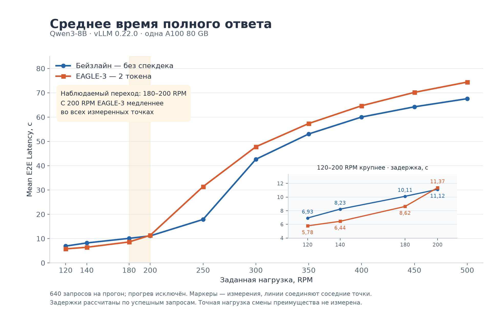
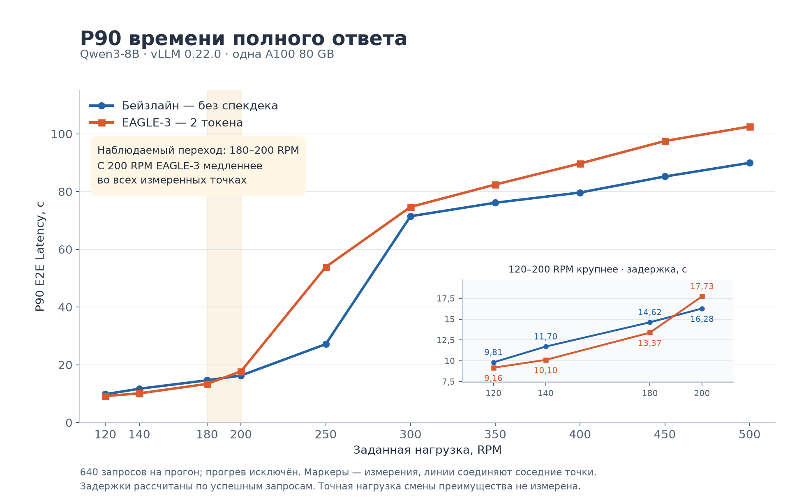
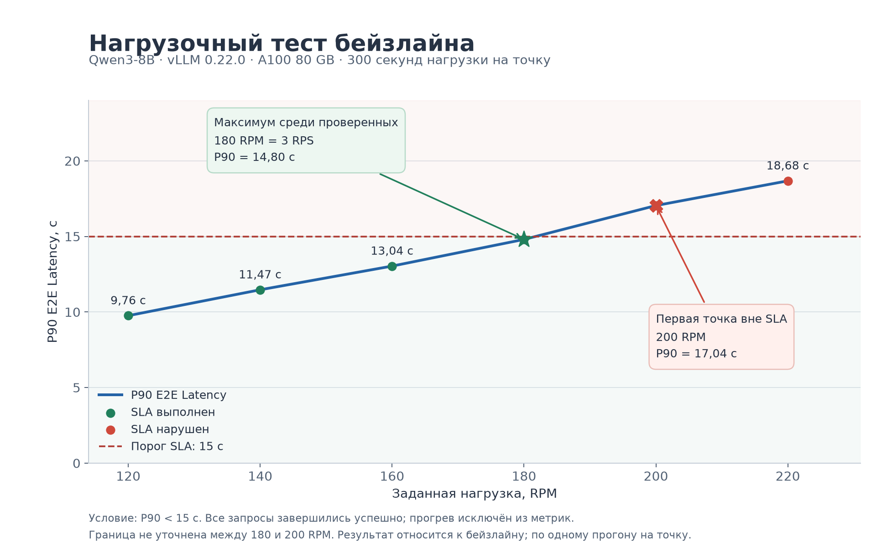

# Отчёт

## Уменьшаем средний Latency при фиксированной нагрузке

Цель — уменьшить среднее время полного ответа модели при фиксированной нагрузке 120 RPM (2 запроса в секунду). Сначала измеряем дефолтный vLLM, затем сравниваем с ним изменённые конфигурации. Основная метрика ускорения: **S = Mean Latency бейзлайна / Mean Latency конфигурации**. Дополнительно отслеживаем P90 E2E Latency.

### Общая методика замера

Все конфигурации сравниваем на одной NVIDIA A100-SXM4-80GB (физическая GPU1), с моделью `Qwen/Qwen3-8B` и одинаковой нагрузкой. Исходное окружение задано в [Dockerfile](Dockerfile): vLLM 0.22.0 и AIPerf 0.13.0. Сервер модели запускается через [serve.sh](serve.sh); при смене конфигурации перезапускаем его с нужными аргументами и дожидаемся готовности.

Нагрузку создаёт AIPerf через [benchmark.sh](benchmark.sh). Данные — 640 запросов из неизменённого [data/requests.jsonl](data/requests.jsonl). В каждом запросе заданы `temperature=0`, `seed=42`, `max_tokens=512` и `enable_thinking=false`. Лимит 512 токенов — верхняя граница: модель может завершить ответ раньше.

Перед прогоном скрипт очищает prefix cache, затем выполняет 40 прогревочных запросов с параллельностью 8. Прогрев не входит в итоговые метрики. В основном замере запросы отправляются последовательно из файла с постоянной частотой 2 запроса в секунду, без ожидания завершения предыдущих ответов. После прогона prefix cache очищается повторно. Скачивание весов и запуск сервера происходят до замера.

AIPerf измеряет E2E Latency каждого запроса от отправки до получения полного ответа, включая ожидание в очереди и генерацию. Среднее и перцентили берутся из строки `Request Latency (ms)`; миллисекунды переводятся в секунды.

Для каждой конфигурации сохраняем параметры запуска, Mean E2E Latency, P90, число успешных запросов и ошибок, а также ускорение S относительно бейзлайна. Каждый прогон записывается в отдельную папку результатов. Скрипт [load_test.sh](load_test.sh) предназначен для последующего нагрузочного тестирования длительностью 300 секунд; в этом этапе используется [benchmark.sh](benchmark.sh).

### Конфигурация 1 — бейзлайн vLLM

Использован дефолтный vLLM 0.22.0 из [Dockerfile](Dockerfile). Скрипт [serve.sh](serve.sh) запущен без дополнительных аргументов: настройки движка оставлены по умолчанию, speculative decoding не используется.

#### Результаты

| Метрика | Значение |
|---|---:|
| Заданная нагрузка | 120 RPM |
| Успешные запросы основного замера | 640 из 640 |
| Доля ошибок | 0% |
| Mean E2E Latency | 6,92625 с |
| P90 E2E Latency | 9,80577 с |
| P99 E2E Latency | 11,22308 с |
| Среднее время до первого токена (TTFT) | 120,23 мс |
| Длительность основного замера, по AIPerf | 325,95 с |
| Ускорение S | 1,00 |

Среднее время полного ответа бейзлайна составило около 6,93 с, а 90% запросов завершились примерно за 9,81 с или быстрее. Этот прогон служит точкой отсчёта для сравнения следующих конфигураций.

#### Команды запуска

Запуск дефолтного vLLM через [serve.sh](serve.sh) в первом терминале с сохранением лога:

```bash
sudo docker exec -it infer_mavletova \
  bash -o pipefail -c 'bash serve.sh 2>&1 | tee logs/vllm-baseline.log'
```

После загрузки модели — проверка готовности и запуск замера через [benchmark.sh](benchmark.sh) во втором терминале, также подключённом к серверу:

```bash
curl -fsS http://127.0.0.1:8000/health && echo "Модель готова"

sudo docker exec -it infer_mavletova \
  bash -o pipefail -c 'bash benchmark.sh results/baseline 2>&1 | tee logs/benchmark-baseline.log'
```


### Конфигурация 2 — tokens1024

Использован vLLM 0.22.0 из [Dockerfile](Dockerfile). В [serve.sh](serve.sh) передан `--max-num-batched-tokens 1024`: бюджет токенов на один шаг уменьшен с исходных 2048 до 1024. Остальные настройки оставлены по умолчанию. Проверяем, уменьшит ли обработка промптов меньшими частями задержки генерации текущих ответов.

#### Результаты

| Метрика | Значение |
|---|---:|
| Заданная нагрузка | 120 RPM |
| Успешные запросы основного замера | 640 из 640 |
| Доля ошибок | 0% |
| Mean E2E Latency | 7,01485 с |
| P90 E2E Latency | 9,91990 с |
| P99 E2E Latency | 11,67420 с |
| Среднее время до первого токена (TTFT) | 128,28 мс |
| Длительность основного замера, по AIPerf | 325,97 с |
| Ускорение S | 0,987 |

Ускорения в этом прогоне не получено: средняя задержка выросла на 1,28%, P90 — на 1,16% относительно бейзлайна. Ожидаемое преимущество меньшего бюджета токенов не проявилось. Разница небольшая; по одному прогону нельзя отделить влияние настройки от колебаний между запусками.

#### Команды запуска

Запуск конфигурации через [serve.sh](serve.sh) в первом терминале с сохранением лога:

```bash
sudo docker exec -it infer_mavletova \
  bash -o pipefail -c 'bash serve.sh --max-num-batched-tokens 1024 2>&1 | tee logs/vllm-tokens1024.log'
```

После загрузки модели — проверка готовности и запуск замера через [benchmark.sh](benchmark.sh) во втором терминале, также подключённом к серверу:

```bash
curl -fsS http://127.0.0.1:8000/health && echo "Модель готова"

sudo docker exec -it infer_mavletova \
  bash -o pipefail -c 'bash benchmark.sh results/tokens1024 2>&1 | tee logs/benchmark-tokens1024.log'
```

### Конфигурация 3 — flashinfer

Использован vLLM 0.22.0 из [Dockerfile](Dockerfile). В [serve.sh](serve.sh) передан `--attention-backend FLASHINFER`: вместо выбранного в бейзлайне FlashAttention 2 используется FlashInfer. Остальные настройки оставлены по умолчанию, включая бюджет 2048 токенов. Проверяем влияние другой реализации attention на время ответа.

#### Результаты

| Метрика | Значение |
|---|---:|
| Заданная нагрузка | 120 RPM |
| Успешные запросы основного замера | 640 из 640 |
| Доля ошибок | 0% |
| Mean E2E Latency | 6,26774 с |
| P90 E2E Latency | 8,46156 с |
| P99 E2E Latency | 9,37372 с |
| Среднее время до первого токена (TTFT) | 113,83 мс |
| Длительность основного замера, по AIPerf | 325,75 с |
| Ускорение S | 1,105 |

Средняя задержка снизилась на 9,51%, P90 — на 13,71% относительно бейзлайна. Ускорение составило 1,105×. Среднее время между токенами уменьшилось с 16,12 до 14,57 мс, что согласуется с ускорением генерации. Среди проведённых прогонов при 120 RPM эта конфигурация показала лучший P90.

#### Команды запуска

Запуск конфигурации через [serve.sh](serve.sh) в первом терминале с сохранением лога:

```bash
sudo docker exec -it infer_mavletova \
  bash -o pipefail -c 'bash serve.sh --attention-backend FLASHINFER 2>&1 | tee logs/vllm-flashinfer.log'
```

После загрузки модели — проверка готовности и запуск замера через [benchmark.sh](benchmark.sh) во втором терминале, также подключённом к серверу:

```bash
curl -fsS http://127.0.0.1:8000/health && echo "Модель готова"

sudo docker exec -it infer_mavletova \
  bash -o pipefail -c 'bash benchmark.sh results/flashinfer 2>&1 | tee logs/benchmark-flashinfer.log'
```

### Конфигурация 4 — spec-draft3

Использован vLLM 0.22.0 из [Dockerfile](Dockerfile). Через [serve.sh](serve.sh) включён speculative decoding методом `draft_model`: основная модель `Qwen/Qwen3-8B` проверяет до трёх токенов, предложенных помощником `Qwen/Qwen3-0.6B`. Обе модели работают на GPU1. Для этого метода vLLM автоматически выбирает model runner V1 вместо V2; версия самого движка не меняется.

#### Результаты

| Метрика | Значение |
|---|---:|
| Заданная нагрузка | 120 RPM |
| Успешные запросы основного замера | 640 из 640 |
| Доля ошибок | 0% |
| Mean E2E Latency | 8,23121 с |
| P90 E2E Latency | 12,18293 с |
| P99 E2E Latency | 15,26793 с |
| Среднее время до первого токена (TTFT) | 170,67 мс |
| Длительность основного замера, по AIPerf | 327,36 с |
| Ускорение S | 0,841 |

Конфигурация оказалась медленнее бейзлайна: средняя задержка выросла на 18,84%, P90 — на 24,24%. Из 313 656 предложенных токенов приняты 164 154 (52,34%), в среднем 1,57 из 3 за итерацию. Ускорения всей связки не получено. Поскольку одновременно сменился model runner, для выделения эффекта самого спекдека нужен отдельный контрольный прогон V1 без него.

#### Команды запуска

Запуск конфигурации через [serve.sh](serve.sh) в первом терминале с сохранением лога:

```bash
sudo docker exec -it infer_mavletova \
  bash -o pipefail -c 'bash serve.sh --speculative-config "{\"method\":\"draft_model\",\"model\":\"Qwen/Qwen3-0.6B\",\"num_speculative_tokens\":3}" 2>&1 | tee logs/vllm-spec-draft3.log'
```

После загрузки модели — проверка готовности и запуск замера через [benchmark.sh](benchmark.sh) во втором терминале, также подключённом к серверу:

```bash
curl -fsS http://127.0.0.1:8000/health && echo "Модель готова"

sudo docker exec -it infer_mavletova \
  bash -o pipefail -c 'bash benchmark.sh results/spec-draft3 2>&1 | tee logs/benchmark-spec-draft3.log'
```

### Конфигурация 5 — eagle3-k2

Использован vLLM 0.22.0 из [Dockerfile](Dockerfile). Через [serve.sh](serve.sh) включён speculative decoding методом `eagle3` с помощником `AngelSlim/Qwen3-8B_eagle3`, который предлагает до двух токенов за итерацию. Основная модель остаётся `Qwen/Qwen3-8B`; обе модели работают на GPU1. Используется model runner V2, как в бейзлайне. FlashInfer и дополнительные настройки CUDA graphs не включались.

#### Результаты

| Метрика | Значение |
|---|---:|
| Заданная нагрузка | 120 RPM |
| Успешные запросы основного замера | 640 из 640 |
| Доля ошибок | 0% |
| Mean E2E Latency | 5,77747 с |
| P90 E2E Latency | 9,16415 с |
| P99 E2E Latency | 11,87837 с |
| Среднее время до первого токена (TTFT) | 132,43 мс |
| Длительность основного замера, по AIPerf | 324,49 с |
| Ускорение S | 1,199 |

Средняя задержка снизилась на 16,59%, P90 — на 6,54% относительно бейзлайна. Ускорение составило 1,199× — лучший результат по основной метрике среди проведённых прогонов при 120 RPM. При этом P90 выше, чем у FlashInfer (9,16 против 8,46 с), а P99 выше бейзлайна (11,88 против 11,22 с): улучшение среднего не распространяется одинаково на все запросы.

#### Команды запуска

Запуск конфигурации через [serve.sh](serve.sh) в первом терминале с сохранением лога:

```bash
sudo docker exec -it infer_mavletova \
  bash -o pipefail -c 'bash serve.sh --speculative-config "{\"method\":\"eagle3\",\"model\":\"AngelSlim/Qwen3-8B_eagle3\",\"num_speculative_tokens\":2}" 2>&1 | tee logs/vllm-eagle3-k2.log'
```

После загрузки модели — проверка готовности и запуск замера через [benchmark.sh](benchmark.sh) во втором терминале, также подключённом к серверу:

```bash
curl -fsS http://127.0.0.1:8000/health && echo "Модель готова"

sudo docker exec -it infer_mavletova \
  bash -o pipefail -c 'bash benchmark.sh results/eagle3-k2 2>&1 | tee logs/benchmark-eagle3-k2.log'
```

### Итоговая таблица при 120 RPM

| Конфигурация | Mean E2E Latency, с | P90 E2E Latency, с | P99 E2E Latency, с | Средний TTFT, мс | Длительность замера, с | Успешные запросы | Ошибки, % | Ускорение S |
|---|---:|---:|---:|---:|---:|---:|---:|---:|
| Бейзлайн vLLM | 6,92625 | 9,80577 | 11,22308 | 120,23 | 325,95 | 640 из 640 | 0 | 1,000 |
| tokens1024 | 7,01485 | 9,91990 | 11,67420 | 128,28 | 325,97 | 640 из 640 | 0 | 0,987 |
| flashinfer | 6,26774 | **8,46156** | 9,37372 | 113,83 | 325,75 | 640 из 640 | 0 | 1,105 |
| spec-draft3 | 8,23121 | 12,18293 | 15,26793 | 170,67 | 327,36 | 640 из 640 | 0 | 0,841 |
| eagle3-k2 | 5,77747 | 9,16415 | 11,87837 | 132,43 | 324,49 | 640 из 640 | 0 | **1,199** |

По проведённым замерам при 120 RPM лучшая конфигурация по основной метрике — **eagle3-k2**: средняя задержка снизилась на 16,59%, ускорение составило **1,199×**. Минимальный **P90 — 8,46 с — показал FlashInfer**, улучшив его на 13,71% относительно бейзлайна. Уменьшение бюджета токенов до 1024 и спекдек с Qwen3-0.6B ускорения не дали. Все пять прогонов завершились без ошибок; результаты получены по одному прогону каждой конфигурации.


## Исследование спекулятивного декодирования

### Сетап

Сравниваем дефолтный vLLM 0.22.0 без спекдека и конфигурацию **eagle3-k2**: Qwen3-8B с помощником `AngelSlim/Qwen3-8B_eagle3`, предлагающим два токена за итерацию. Обе конфигурации работают на одной A100 80 GB (GPU1), с model runner V2 и остальными настройками по умолчанию.

Нагрузку задаём через `RPM` в [benchmark.sh](benchmark.sh): **120, 140, 180, 200, 250, 300, 350, 400, 450 и 500 RPM**. Для каждой точки используем все 640 запросов из неизменённого [data/requests.jsonl](data/requests.jsonl), поэтому длительность прогона зависит от RPM. Параметры генерации прежние: reasoning отключён, `temperature=0`, `seed=42`, `max_tokens=512`. Перед каждым прогоном очищаем prefix cache и выполняем 40 прогревочных запросов с параллельностью 8; результаты сохраняем отдельно. Точки 120 RPM берём из предыдущего этапа. Точки 140 и 180 RPM также получены через [benchmark.sh](benchmark.sh), а не из 300-секундных нагрузочных тестов следующего раздела.

Основная метрика — **P90 E2E Latency**, дополнительно сохраняем среднюю задержку. Строим две зависимости P90 от RPM и определяем нагрузку, при которой P90 со спекдеком становится выше, чем без него. Если смена преимущества происходит между измеренными точками, указываем интервал перехода.

### Результаты замеров

| Нагрузка, RPM | Mean бейзлайна, с | Mean EAGLE-3, с | P90 бейзлайна, с | P90 EAGLE-3, с |
|---|---:|---:|---:|---:|
| 120 | 6,926 | 5,777 | 9,806 | 9,164 |
| 140 | 8,229 | 6,444 | 11,703 | 10,102 |
| 180 | 10,110 | 8,619 | 14,619 | 13,374 |
| 200 | 11,124 | 11,366 | 16,276 | 17,729 |
| 250 | 17,882 | 31,379 | 27,149 | 53,877 |
| 300 | 42,651 | 47,797 | 71,463 | 74,683 |
| 350 | 53,057 | 57,363 | 76,137 | 82,435 |
| 400 | 60,024 | 64,661 | 79,661 | 89,732 |
| 450 | 64,231 | 70,167 | 85,226 | 97,518 |
| 500 | 67,575 | 74,407 | 89,944 | 102,532 |

Mean и P90 взяты из `request_latency` и рассчитаны по успешным запросам.

### Средняя задержка в зависимости от нагрузки

На одном графике показаны Mean E2E Latency бейзлайна и EAGLE-3. Для каждой из десяти нагрузок выполнено по одному прогону каждой конфигурации — всего 20 прогонов. Маркеры соответствуют измерениям, линии соединяют соседние точки. Область **180–200 RPM** выделена как наблюдаемый интервал смены преимущества. На вставке крупнее показаны четыре точки от 120 до 200 RPM.



### P90 задержки в зависимости от нагрузки



Численные данные графиков сохранены в [сводке метрик](figures/speculative_sweep_metrics.json). Для воспроизведения доступны [скрипт сбора метрик](scripts/collect_sweep.py) и [скрипт построения графиков](scripts/plot_speculative_sweep.py).

### Вывод

При **120 RPM** EAGLE-3 уменьшает среднюю задержку с 6,93 до 5,78 с (на 16,59%), а P90 — с 9,81 до 9,16 с (на 6,54%). При **140 RPM** преимущество сохраняется: средняя задержка снижается с 8,23 до 6,44 с (на 21,69%), P90 — с 11,70 до 10,10 с (на 13,68%). При **180 RPM** по успешным запросам EAGLE-3 также быстрее: Mean составляет 8,62 с против 10,11 с, P90 — 13,37 с против 14,62 с.

При **200 RPM** преимущество исчезает: средняя задержка составляет 11,37 с против 11,12 с у бейзлайна, P90 — 17,73 с против 16,28 с. Таким образом, **200 RPM остаётся первой измеренной нагрузкой, при которой спекдек хуже по обеим метрикам; наблюдаемый интервал перехода сузился до 180–200 RPM**. Для поиска точной границы нужны дополнительные точки между 180 и 200 RPM.

На всех проверенных нагрузках от 250 до 500 RPM EAGLE-3 также медленнее. Особенно заметна разница при 250 RPM: P90 составляет 53,88 с против 27,15 с у бейзлайна. При 500 RPM средняя задержка достигает 74,41 с против 67,58 с, а P90 — 102,53 с против 89,94 с. Разрыв между конфигурациями меняется не монотонно.

Наблюдение согласуется с ожидаемым компромиссом: при небольшой нагрузке принятие нескольких токенов за проверку может сократить число последовательных проходов основной модели; с ростом нагрузки работа помощника и проверка кандидатов конкурируют за ресурсы GPU с обработкой других запросов, и выигрыш может исчезнуть.


## Нагрузочное тестирование

### Сетап

В этой серии проверяем **бейзлайн vLLM 0.22.0** с Qwen3-8B на одной A100 80 GB (GPU1), без дополнительных параметров [serve.sh](serve.sh). Условие SLA — **P90 E2E Latency < 15 секунд**. Нагрузку 120, 140, 160, 180, 200 и 220 RPM подаём через [load_test.sh](load_test.sh) в течение **300 секунд на каждую точку**. Используем неизменённый [data/requests.jsonl](data/requests.jsonl) и прежние параметры генерации. Перед каждым прогоном очищаем prefix cache и выполняем 40 прогревочных запросов с параллельностью 8; после прогона кеш очищаем повторно. Прогрев не входит в метрики, завершения отправленных запросов дожидаемся после окончания подачи нагрузки.

### Результаты бейзлайна

| Нагрузка, RPM | Mean E2E Latency, с | P90 E2E Latency, с | Успешные запросы | Ошибки | SLA: P90 < 15 с |
|---|---:|---:|---:|---:|---|
| 120 | 6,931 | 9,759 | 600 | 0 | Выполнен |
| 140 | 7,993 | 11,472 | 699 | 0 | Выполнен |
| 160 | 9,113 | 13,040 | 800 | 0 | Выполнен |
| **180** | 10,334 | **14,804** | 899 | 0 | **Максимум среди проверенных** |
| **200** | 11,502 | **17,045** | 999 | 0 | **Первая точка вне SLA** |
| 220 | 12,793 | 18,679 | 1099 | 0 | Нарушен |



Данные сохранены в [сводке нагрузочных тестов](figures/sla_baseline_metrics.json). Для воспроизведения доступны [скрипт сбора метрик](scripts/collect_sla.py) и [скрипт построения графика](scripts/plot_sla_baseline.py).

### Вывод по бейзлайну

**Максимальная проверенная нагрузка бейзлайна, удовлетворяющая SLA, — 180 RPM (3 RPS): P90 = 14,804 с.** При 200 RPM P90 достигает 17,045 с, условие нарушается. Точная граница между 180 и 200 RPM не измерена. При 180 RPM запас до порога составляет всего около 0,20 с; результат получен по одному прогону на точку. Все шесть прогонов завершились без ошибок. Эта серия устанавливает результат для бейзлайна; предел лучшей оптимизированной конфигурации требует отдельного нагрузочного теста.
